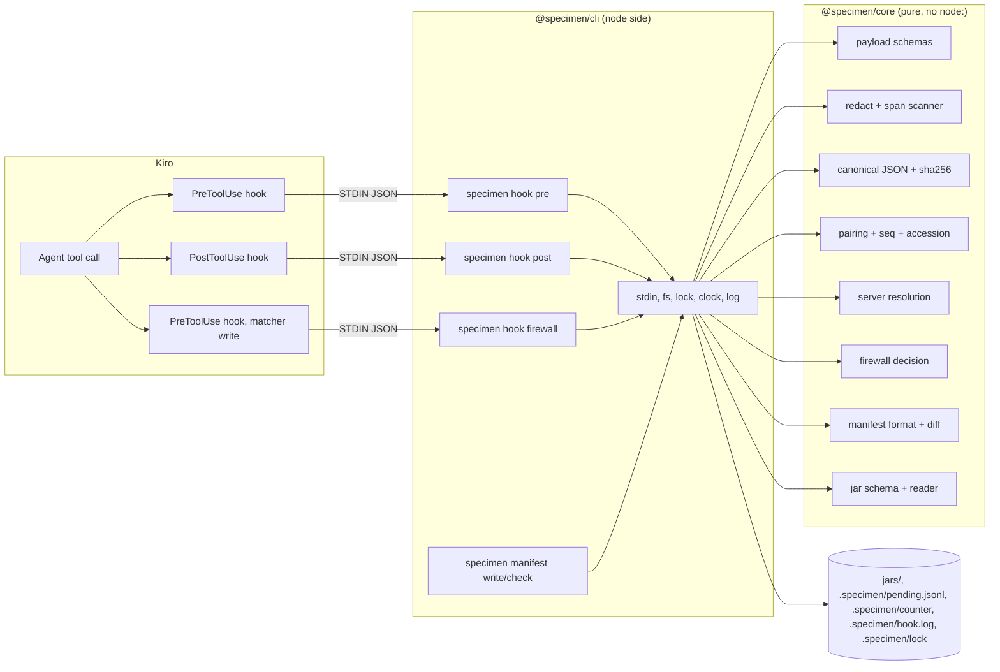
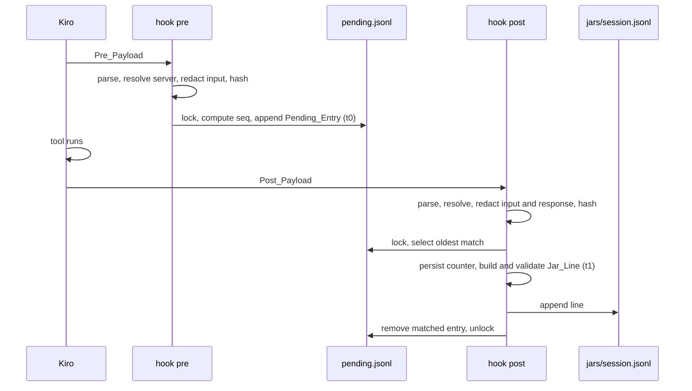

# Design Document

## Overview

Jar capture records every MCP tool call a Kiro agent makes against the demo server into an append-only jar under `jars/`. Kiro's PreToolUse and PostToolUse hooks run `specimen hook pre` and `specimen hook post`. The pre hook leaves a pending entry. The post hook pairs the response with that entry and appends one Jar_Line. A third hook, `specimen hook firewall`, blocks Kiro's write tool from touching `jars/`. `specimen manifest write|check` seals the jars and detects later changes.

The design splits into two workspace packages.

- `@specimen/core` (`packages/core`) holds pure logic: the Jar_Schema, Canonical_JSON, SHA-256, pairing, server resolution, span-preserving redaction, the firewall decision and the manifest format. It has no `node:` imports, reads no clock, file system or network, and receives time, file contents and STDIN text as arguments. The browser cabinet can bundle it.
- `@specimen/cli` (`packages/cli`) holds the process side: the `specimen` bin, `commander` wiring, STDIN, files, the lock, the clock and exit codes.

### Research findings that shape the design

| Finding | Source | Consequence |
|---|---|---|
| Kiro hook payloads carry `session_id, hook_event_name, cwd, tool_name, tool_input`, plus `tool_response` as a string on PostToolUse. No timestamp, call id or duration. | `evidence/spikes/S3.md` | The pre hook stamps `t0`. The post hook stamps `t1`. Pairing needs a derived key (`session_id`, `tool_id`, `input_sha256`). |
| Kiro writes `-` as `_` inside `tool_name`, so `hollow-inn-x` becomes `mcp_hollow_inn_x_...`. | `evidence/spikes/S3.md` | Server resolution by name is ambiguous in general. The shipped hooks pass `--server hollowinn`. Name parsing is only the fallback. |
| hollow-inn `quote` returns `{"room_id":"r-04","nights":2,"nightly":212.50,"total":425.00,"currency":"USD"}`. `JSON.parse` turns `425.00` into `425`. | `servers/hollow-inn/src/money.ts`, `servers/hollow-inn/test/v1.test.ts` | `response_text` is the source of truth and is never produced by `JSON.stringify`. Redaction edits the raw text by character span. |
| The repo already uses zod 4 (`zod ^4.6.7` in `servers/hollow-inn`), TypeScript strict with `noUncheckedIndexedAccess`, `moduleResolution: Bundler`, ESM, vitest `include` of `{packages,servers,apps,spikes}/**/test/**/*.test.ts`. | root config files | `packages/*` is already in the root `workspaces` and in vitest `include`. New packages need no root config change except dev dependencies. |
| `fast-check` and `commander` are not installed yet. | `node_modules` | Add `fast-check` to the root `devDependencies` and `commander`, `zod`, `tsx` to the package manifests. Versions are fixed at install time. |

### Key design decisions

1. **Raw-text fidelity.** There are two representations of a response. `response_text` is the exact text Kiro handed over, modified only by replacing whole JSON value spans with the string literal `"[REDACTED]"`. `response` is `JSON.parse(response_text)` and so holds `425`. Nothing rewrites `response_text` from `response`. A strict JSON scanner in core reports the character span of every value, so redaction is a text splice. Canonical_JSON is only applied to `tool_input`, which arrives already parsed from the hook payload, so it has no literal to preserve.
2. **Redact once, before everything else.** Redaction runs first. The Input_Hash, `response_text`, `response_length` and the hashed form are all derived from redacted values (Requirement 7 criterion 22). The pre and post hooks call the same `redactInput` and `inputHash` functions on the same payload field, so they compute equal hashes.
3. **Fail open and silent for capture hooks, fail closed for secrets.** Capture hooks always exit 0 and print nothing. When a redaction config is invalid they record nothing instead of storing unredacted data.
4. **One lock, short critical section.** All parsing, redaction and hashing happen before the lock. Inside the lock the hook reads state, appends, and rewrites the pending file.

## Architecture



Data flow for one call:



### Repository layout

```
packages/core/
  package.json            name @specimen/core, exports "." -> ./src/index.ts
  src/index.ts            re-exports
  src/json.ts             Json type, canonicalJson, isJsonObjectOrArray
  src/sha256.ts           sha256Hex(string | Uint8Array)
  src/jar.ts              jarLineSchema, serializeJarLine, readJar, readJarTolerant
  src/accession.ts        formatAccession, parseAccession, maxAccession, parseCounter
  src/payload.ts          prePayloadSchema, postPayloadSchema, validateSessionId, fieldPaths
  src/server.ts           mcpConfigSchema, resolveServer
  src/redact.ts           redactConfigSchema, DEFAULT_REDACT_CONFIG, compileRedact, redactInput, redactResponse
  src/scan.ts             scanJson (value spans and pointers)
  src/pairing.ts          pendingEntrySchema, parsePending, selectPending, nextSeq, buildJarLine, durationMs
  src/firewall.ts         lexicalResolve, decideFirewall, candidatePaths
  src/manifest.ts         formatManifest, parseManifest, diffManifest
  test/*.test.ts
packages/cli/
  package.json            name @specimen/cli, bin { "specimen": "./bin/specimen.mjs" }
  bin/specimen.mjs        node shebang, registers tsx, imports src/main.ts
  src/main.ts             commander program
  src/hooks/{run,pre,post,firewall}.ts
  src/io/{stdin,fsx,lock,log,root,jars}.ts
  src/manifest.ts         manifest write/check commands
  test/*.test.ts
.specimen/redact.json     shipped default, equal to DEFAULT_REDACT_CONFIG
.kiro/settings/mcp.json   registers hollowinn
.kiro/hooks/*.json        five hook files (Requirement 9)
```

### How the CLI runs from source and resolves from the repo root

There is no build step. The bin is a small JavaScript file that registers tsx in-process and then imports the TypeScript entry.

```js
#!/usr/bin/env node
// packages/cli/bin/specimen.mjs
import { register } from "tsx/esm/api";
register();
await import("../src/main.ts");
```

`packages/cli/package.json` declares `"bin": { "specimen": "./bin/specimen.mjs" }`, `"type": "module"`, and `tsx` as a regular dependency. Resolution from the repo root:

1. `npm install` at the root links workspaces. npm creates `node_modules/@specimen/core` and `node_modules/@specimen/cli` as symlinks to the package folders, and creates `node_modules/.bin/specimen` pointing at `packages/cli/bin/specimen.mjs` with the executable bit set. Install must be re-run once after the cli package is added, because the link does not exist before.
2. A Kiro hook runs `npx --no-install specimen hook pre --server hollowinn` with the workspace as its working directory. `npx --no-install` finds `node_modules/.bin/specimen` by walking up from the working directory and never downloads anything (no network, per the tech rules).
3. The shebang uses `node`, not `tsx`, so no PATH lookup for `tsx` is needed. `tsx` is imported as a module from the workspace root `node_modules`.
4. `@specimen/core` resolves to `packages/core/src/index.ts` through the `exports` field. tsx transforms it on the fly, and Vite resolves the same field for the cabinet. Source files import siblings as `./x.js`, matching the existing hollow-inn convention, which tsx and Vite map to `.ts`.

Alternative considered: a `#!/usr/bin/env tsx` shebang. It works only when `tsx` is on PATH. `npx` adds `node_modules/.bin` to PATH, but a direct `./node_modules/.bin/specimen` call would not. The node shebang with in-process registration works in both cases.

The cost of this choice is tsx start-up time on each hook call. This design makes no latency claim. The tasks phase measures it and records the number in `evidence/`.

To guarantee silence even when Node or tsx prints a warning, the bin runs `process.removeAllListeners("warning")` before registering tsx. The capture hook runner also replaces `process.stdout.write` and `process.stderr.write` with no-ops. The firewall writes its single message with `fs.writeSync(2, ...)`, which bypasses that replacement.

## Components and Interfaces

All core functions are pure. Types below are TypeScript; zod schemas use the zod 4 API (`z.strictObject`, `z.iso.datetime`).

### core/json.ts and core/sha256.ts

```ts
export type Json = null | boolean | number | string | Json[] | { [k: string]: Json };

/** Sorted keys (UTF-16 code unit order, the default string sort), no whitespace,
 *  JSON.stringify for strings and numbers, array order kept. Builds the text by
 *  concatenation, never by assigning keys onto an object, so "__proto__" and
 *  "constructor" are ordinary keys. Iterative stack for depth safety is not required;
 *  recursion depth failures surface as caught exceptions in the hook. */
export function canonicalJson(v: Json): string;

/** true when JSON.parse(text) yields an object or array (a JSON_Response). */
export function isJsonResponse(text: string): boolean;

/** SHA-256, lowercase hex. Strings are encoded with TextEncoder (a global, not node:).
 *  Uint8Array input is accepted so the manifest can hash file bytes. */
export function sha256Hex(input: string | Uint8Array): string;

export function inputHash(redactedInput: Json): string; // sha256Hex(canonicalJson(x))
```

`sha256Hex` is a straight implementation of FIPS 180-4 on `Uint32Array`. It is tested against `node:crypto` in the test suite only.

### core/jar.ts

```ts
export const jarLineSchema = z.strictObject({
  v: z.literal(1),
  id: z.string().regex(/^SPC-\d{4,}$/),
  session_id: sessionIdSchema,                        // regex + no ".." refine
  seq: z.number().int().min(1).max(2147483647),       // unique within a jar; call start order
  server: z.string().min(1),
  tool: z.string().min(1),
  tool_id: z.string().min(1),
  input: jsonSchema,
  response_text: z.string(),
  response: jsonSchema.nullable(),
  t0: utcOrOffsetDateTime, t1: utcOrOffsetDateTime,
  duration_ms: z.number().int().min(0).max(2147483647), // includes hook overhead
  redacted: z.array(jsonPointerSchema),
  text_redacted: z.boolean().optional(),
  unpaired: z.boolean().optional(),
  response_length: z.number().int().min(0).optional(),
}).superRefine(/* response_length present => response_text matches ^sha256:[0-9a-f]{64}$ and response === null */);

export type JarLine = z.infer<typeof jarLineSchema>;
export function serializeJarLine(l: JarLine): string;   // JSON.stringify(l) + "\n"
export type JarError = { line: number; kind: "json" | "schema" | "unknown_field" | "blank" | "incomplete"; field?: string };
export function readJar(text: string): { lines: JarLine[]; errors: JarError[] };
export function readJarTolerant(text: string): JarLine[];  // skips every invalid line, never throws
```

Schema comments document that `seq` is unique within a jar and gives call start order, that file order is completion order, and that `duration_ms` includes hook overhead (1.16, 1.22, 1.23). Field order of a written line is fixed by `buildJarLine`: `v,id,session_id,seq,server,tool,tool_id,input,response_text,response,t0,t1,duration_ms,redacted`, then the optional fields.

`readJar` splits on `\n`. A final empty segment after the last newline is not a line. A non-empty final segment is an `incomplete` error. A blank segment before the final line is a `blank` error. An `unrecognized_keys` zod issue becomes an `unknown_field` error with the key name.

`jsonPointerSchema` rejects the empty string, because it does not point into a field. It accepts only `/`-separated tokens in which `~` appears only as `~0` or `~1`, and requires the first token to be one of the Jar_Line fields (`input`, `response`).

### core/payload.ts

```ts
export const sessionIdRe = /^[A-Za-z0-9][A-Za-z0-9._-]{0,127}$/;
export function validSessionId(s: string): boolean;   // regex and no ".."

export const prePayloadSchema = z.looseObject({
  session_id: z.string(), cwd: z.string(), tool_name: z.string(), hook_event_name: z.string().optional(),
  tool_input: z.unknown(),
}).refine(o => Object.hasOwn(o, "tool_input"), { path: ["tool_input"] });
export const postPayloadSchema = /* prePayloadSchema fields plus tool_response: z.string() */;

/** Turns zod issues into field paths such as "tool_response". A path segment that is not
 *  /^[A-Za-z0-9_]{1,40}$/ is written as "?". Never uses issue.message. */
export function fieldPaths(issues: z.core.$ZodIssue[]): string[];
```

`session_id` is validated in two steps. The schema only requires a string, so a bad id gets its own diagnostic (Requirement 10 criterion 9) and not a generic schema failure. The `tool_input` value is checked to be a `Json` value after parsing, since a parsed JSON document can only contain JSON values.

### core/server.ts

```ts
export const mcpConfigSchema = z.looseObject({ mcpServers: z.record(z.string(), z.unknown()) });
export type Resolution =
  | { ok: true; server: string; tool: string }
  | { ok: false; reason: "no_match" | "ambiguous" };
export function sanitiseKey(k: string): string;          // "-" -> "_"
export function resolveServer(a: { toolName: string; serverFlag?: string; keys?: string[] }): Resolution;
```

Rules:

- With `serverFlag`: `server = serverFlag`. If `toolName` starts with `mcp_${sanitiseKey(flag)}_`, `tool` is the rest, else `tool = toolName` (5.1, 5.7).
- Without a flag, only keys that fully match `^[A-Za-z0-9_-]+$` take part (5.8). A key matches when `toolName` starts with `mcp_${sanitiseKey(key)}_`. One match gives `ok`. Zero matches gives `no_match`. Two or more matching keys give `ambiguous`. Two distinct keys with the same sanitised form both match, so they are ambiguous exactly when that form is a prefix of the tool name (5.2, 5.3). I read Requirement 5 criterion 3 this way, so an unrelated key collision elsewhere in the config does not block a call that does not involve it.
- A missing or invalid `mcp.json` with no flag is handled by the cli, which logs and records nothing (5.6).

### core/redact.ts and core/scan.ts

```ts
export const redactConfigSchema = z.strictObject({
  keys: z.array(z.string()), patterns: z.array(z.string()), text: z.enum(["redact", "hash"]),
});
export const MARKER = "[REDACTED]";
export const DEFAULT_REDACT_CONFIG: RedactConfig;

export type Compiled = { keys: Set<string>; res: RegExp[]; text: "redact" | "hash" };
/** new RegExp(src, "g") per pattern. Returns the index of the first pattern that does not
 *  compile or whose non-global copy matches "". */
export function compileRedact(c: RedactConfig): { ok: true; value: Compiled } | { ok: false; patternIndex: number };

export function redactInput(input: Json, c: Compiled): { value: Json; pointers: string[] };

export type ScanNode =
  | { kind: "scalar"; start: number; end: number }
  | { kind: "string"; start: number; end: number; decoded: string }
  | { kind: "array"; start: number; end: number; items: ScanNode[] }
  | { kind: "object"; start: number; end: number; members: { key: string; value: ScanNode }[] };
export function scanJson(text: string): ScanNode;      // strict RFC 8259; throws ScanError with no text excerpt

export type ResponseResult = {
  responseText: string; response: Json | null; pointers: string[];
  textRedacted: boolean; responseLength?: number;
};
export function redactResponse(toolResponse: string, c: Compiled): ResponseResult;
```

**Input redaction.** A depth-first walk over the parsed `tool_input`. At each object member whose key is in `keys` (exact, case-sensitive), the value of any type becomes `MARKER` and its pointer is recorded. A string value, including a string array element, whose content contains a match for any pattern becomes `MARKER` as a whole. Output objects are built with `Object.defineProperty` so a key named `__proto__` stays an own data property. Pointers get `/input` prepended by the caller and use `~0`/`~1` escaping.

**Response redaction, JSON_Response.** `redactResponse` first calls `isJsonResponse`. If true, it runs `scanJson(toolResponse)` and walks the tree top-down. A value is located when it sits under a member whose key is in `keys`, or when it is a string whose decoded content matches a pattern. A located value is not descended into, so only the outermost value is replaced (7.10). Every member of an object counts, including duplicate keys, because the scanner reports members in text order and does not merge them (7.9). The located spans are applied from the end of the text to the start, each replaced by `JSON.stringify(MARKER)`. Everything outside the spans is copied byte for byte. This is how `"total":425.00` survives, and why `response_text` is unchanged when nothing is located (7.13, 7.14). `response` is `JSON.parse(responseText)`. Pointers are sorted by code-unit order and deduplicated (7.11). `textRedacted` is false.

The scanner has the same grammar as `JSON.parse`. A mismatch would be a defect: `redactResponse` throws, and the hook records nothing and logs a fixed message.

**Response redaction, non-JSON text.** Every match of every pattern is replaced by `MARKER`. Zero-length matches are left alone (`replace(re, m => m.length ? MARKER : m)`), which is a guard in addition to the compile-time rejection. In mode `"redact"` the result is `responseText`. In mode `"hash"`, `responseText = "sha256:" + sha256Hex(replaced)`, `responseLength = replaced.length`, `response = null`. Both modes set `textRedacted = true` whether or not anything matched (7.19). `response` is null in both modes. A response that parses to a scalar, or is empty, is non-JSON text.

**Idempotence.** For `text = "redact"`, a second pass over redacted output yields the same result because `MARKER` replaces whole values and contains no key or pattern match for any config whose patterns do not match inside `MARKER`. The property test generates configs under that precondition (see Property 15).

**Shipped default config** (`.specimen/redact.json`, equal to `DEFAULT_REDACT_CONFIG`):

```json
{
  "keys": ["authorization", "password", "secret", "token", "api_key"],
  "patterns": [
    "Bearer\\s+[A-Za-z0-9._~+/=-]+",
    "sk-[A-Za-z0-9]{20,}",
    "[A-Za-z0-9._%+-]+@[A-Za-z0-9.-]+\\.[A-Za-z]{2,}"
  ],
  "text": "redact"
}
```

Patterns are linear in the input size, which limits regular expression backtracking on untrusted text. User-supplied patterns carry their own risk, and the config is the author's own file.

### core/pairing.ts

```ts
export const pendingEntrySchema = z.strictObject({
  session_id: z.string(), seq: z.number().int().min(1), tool_id: z.string().min(1),
  input_sha256: z.string().regex(/^[0-9a-f]{64}$/), t0: z.string(),
});
export type PendingLine = { line: number; raw: string; entry?: PendingEntry };   // entry absent => invalid
export function parsePending(text: string): PendingLine[];                        // every line kept, 1-based
export function selectPending(p: PendingLine[], k: { session_id: string; tool_id: string; input_sha256: string }): number | undefined;
export function removeLine(text: string, line: number): string;                   // all other lines verbatim, same order
export function nextSeq(sessionId: string, pending: PendingLine[], jarLines: JarLine[]): number;
export function durationMs(t0: string, t1: string): { ms: number; anomaly: boolean };
export function buildJarLine(a: BuildArgs): unknown;                              // caller validates with jarLineSchema
```

`selectPending` returns the lowest line number whose entry is valid and matches all three keys. `nextSeq` is `1 + max(seq)` over the valid pending entries and the jar lines of the same session, or 1 when both are empty. Orphans stay in the pending file, so their `seq` values still count and no `seq` is reused (11.18). `buildJarLine` sets `tool_id` to the raw name, `tool` from server resolution, `input` to the redacted input, `response_text` and `response` from `ResponseResult`, and `redacted` to the sorted, deduplicated union of `/input...` and `/response...` pointers. The unpaired variant sets `unpaired: true`, `t0 = t1` and `duration_ms = 0`.

### core/accession.ts

```ts
export const formatAccession = (n: number): string;        // "SPC-" + padStart(4,"0")
export function parseAccession(id: string): number | undefined;
export function parseCounter(text: string): number | undefined;   // /^\d+$/ after trim and safe integer
export function maxAccession(jarTexts: string[]): number;         // readJarTolerant, max id, 0 if none
```

Accession numbers above `Number.MAX_SAFE_INTEGER` are ignored by `maxAccession`.

### core/firewall.ts

```ts
export function lexicalResolve(cwd: string, p: string): string;   // absolute, "." and ".." collapsed, "\" treated as "/"
export function candidatePaths(toolInput: unknown): string[];     // every string at any depth, iterative walk
export type FirewallCandidate = { lexical: string; real: string };
export function decideFirewall(a: { jarsLexical: string; jarsReal: string; candidates: FirewallCandidate[] }): "block" | "allow";
```

A candidate is blocked when its `lexical` or `real` path equals or lies under `jarsLexical` or `jarsReal` respectively. Both sides are lowercased for comparison (8.12, 8.14). The cli computes `real` as the `fs.realpath` of the longest existing ancestor joined with the remaining segments, and `jarsReal` the same way for `<root>/jars`. The core function only compares strings, so the symlink logic stays out of core. Treating `\` as a separator also blocks a name that is only a backslash path on POSIX. That is a deliberate over-block.

Limitation: every string value counts as a path (8.13). A write whose file body mentions `jars/x` while `cwd` is the workspace root is blocked. This follows the requirement and errs toward protecting evidence.

### core/manifest.ts

```ts
export type ManifestEntry = { path: string; sha256: string };
export function formatManifest(entries: ManifestEntry[]): string;      // "<hex>  <path>\n" lines, sorted by code point
export function parseManifest(text: string): { entries: ManifestEntry[] } | { error: { line: number } };
export function diffManifest(listed: ManifestEntry[], actual: ManifestEntry[], extraUnlisted: string[]):
  { missing: string[]; changed: string[]; unlisted: string[] };
```

Sorting by Unicode code point equals byte order of UTF-8. `parseManifest` accepts only lines `^[0-9a-f]{64}  (.+)$`. `formatManifest` rejects a path that contains `\n` or `\`, because `sha256sum` would need its escape form. `extraUnlisted` carries symbolic links found by the cli (8.17).

### cli/hooks and io

```ts
// hooks/run.ts
export async function runCapture(name: "pre" | "post", argv: string[], io: HookIO): Promise<void>;
export interface HookIO { readStdin(): Promise<string>; now(): number; fs: FsPort; cwd(): string; }
```

`HookIO` is the seam that lets tests call the same code in process and through real child processes. It is not a mock of the MCP protocol. The production implementation uses the real file system.

**`io/root.ts`.** `findWorkspaceRoot(cwd)` walks `cwd` and its ancestors and returns the first directory containing `.kiro`, else `cwd`. When STDIN is unusable, so `cwd` is unknown, the hook uses `process.cwd()` for locating the Hook_Log.

**`io/lock.ts`.** `withLock(path, fn)` loops: `open(path, "wx")` and write a random nonce. On `EEXIST` it stats the file and, if `Date.now() - mtimeMs > 10_000`, unlinks it and retries; otherwise it sleeps 15 to 40 ms and retries until 2 s have passed, then throws `LockTimeout`. After `fn` it re-reads the lock file and unlinks it only if the nonce is still its own. Residual risk: two processes can judge the same lock stale at the same instant, and one can delete the other's fresh lock. The critical section lasts milliseconds against a 10 s staleness limit, so this is accepted and noted.

**`io/log.ts`.** `logDiag(root, hook, sessionId | undefined, message)` appends `"<ISO time>\t<hook>\t<session or ->\t<message>\n"` to `.specimen/hook.log` and swallows its own errors. Messages are fixed strings or `fieldPaths(...)` output. Error messages from `JSON.parse`, zod or the file system are never logged. For a thrown error only `err.name` and an `errno` code such as `ENOENT` are written (6.7).

**`io/jars.ts`.** Lists `jars/*` and reads jar texts for `maxAccession` and `nextSeq`. Reads are read-only.

**Hook runner contract.** Every capture hook body is wrapped as:

```ts
try { await body(); } catch (e) { logDiag(root, name, sid, `unexpected ${errName(e)}`); }
process.exitCode = 0;
```

`commander` is created with `exitOverride()` and `configureOutput({ writeOut: noop, writeErr: noop })` for the `hook` subcommands. An invalid or unknown argument then throws `CommanderError`. The runner logs `invalid argument` and exits 0 (6.10). The firewall follows the same wrapper but exits 2 on a block.

### Hook algorithms

**Pre hook** (`specimen hook pre [--server <key>]`)

1. Read STDIN to EOF. Parse JSON, then `prePayloadSchema`. On failure log `fieldPaths` and stop.
2. `root = findWorkspaceRoot(payload.cwd)`. Check `validSessionId`; if false log `session_id invalid` and stop.
3. Load the redact config (missing file gives the default; invalid file or bad pattern gives a log line and stop). Compile it.
4. Resolve the server (flag, else `mcp.json` under `root` parsed with `mcpConfigSchema`). Stop on `no_match`, `ambiguous` or bad config, logging the reason.
5. `{value} = redactInput(tool_input)`; `h = inputHash(value)`; `t0 = new Date(now()).toISOString()`.
6. Under the lock: read `pending.jsonl` (log the line number of each invalid line, keep it), read the session's jar tolerantly, `seq = nextSeq(...)`, and append `{session_id, seq, tool_id, input_sha256, t0}`. If the pending file is non-empty and lacks a final newline, a newline is written first, which turns the torn text into one invalid line that is kept and logged.

**Post hook** (`specimen hook post [--server <key>]`)

1. Parse, validate session id, load config, resolve server as in the pre hook, with `postPayloadSchema`.
2. `t1` is read when the payload is read. Redact the input and compute `h`. Run `redactResponse`. If it throws, log and stop.
3. Under the lock:
   1. Read and parse the pending file. `k = selectPending(...)`.
   2. Read the counter file. If it is missing or `parseCounter` fails (log in the second case), set `n = maxAccession(jars)`. Compute `n + 1` and persist it (write `counter.tmp`, `rename`) before building the line (2.3 to 2.5, 2.7).
   3. With a match: `seq` and `t0` come from the entry. Without one: `seq = nextSeq(...)`, `unpaired: true`, `t0 = t1`.
   4. `buildJarLine`, then `jarLineSchema.safeParse`. On failure log `fieldPaths`, stop, keep the pending entry (4.13).
   5. If `jars/<session>.jsonl` exists, is non-empty and its last byte is not `\n`, log and stop, keep the entry (4.22).
   6. `appendFile(jar, serializeJarLine(line))`. On error log and stop, keep the entry (4.14). Create `jars/` first when missing.
   7. Rewrite the pending file through `removeLine` and a temp file plus `rename`. On error log, keep the jar line (4.23).

The Capture_Hook never writes the Manifest and only appends to `jars/<session_id>.jsonl` (8.19, 10.5).

**Firewall hook** (`specimen hook firewall`)

1. Read STDIN, parse with a loose schema (`tool_input` unknown, `cwd` optional string). On failure log and exit 0 (8.4).
2. `root = findWorkspaceRoot(cwd)`. Candidates come from `candidatePaths(tool_input)`. With none, log and exit 0.
3. For each, compute `lexical = lexicalResolve(cwd, s)` and `real` via the longest existing ancestor.
4. `decideFirewall(...)`. On `block`, write `jars are evidence and read-only` plus a newline to STDERR with `fs.writeSync(2, ...)` and exit 2. Otherwise exit 0. Nothing goes to STDOUT. An unexpected exception logs and exits 0, matching the criterion 4 rationale that a firewall fault must not block unrelated writes and that the manifest check is the backstop.

**Manifest commands** (`specimen manifest write|check`, run from the workspace root via `findWorkspaceRoot(process.cwd())`)

- `write`: `lstat` each entry under `jars/` recursively. Regular files except `jars/MANIFEST.sha256` are hashed (`sha256Hex(bytes)`). Symlinks are skipped. `formatManifest` output is written to `jars/MANIFEST.sha256`. An existing Manifest is replaced because writing is the author's sealing step. If `jars/` does not exist it is created and an empty Manifest is written.
- `check`: read the Manifest (a missing one counts as no entries), hash the actual files, collect symlinks as `extraUnlisted`, call `diffManifest`. All three lists empty gives exit 0. Otherwise each file goes to STDERR as `MISSING <path>`, `CHANGED <path>` or `UNLISTED <path>` and the exit code is 2. A missing Manifest with files in `jars/` therefore gives exit 2, and with no files gives exit 0 (8.18). Unreadable files, a malformed Manifest or a path that `formatManifest` rejects give a STDERR diagnostic and exit 1 (8.16). The command never modifies `jars/`.

### Kiro wiring files

`.kiro/settings/mcp.json`:

```json
{ "mcpServers": { "hollowinn": { "command": "npx", "args": ["tsx", "servers/hollow-inn/src/main.ts", "v1"] } } }
```

Hook files, all `{"version":"v1","hooks":[...]}`:

| File | trigger | matcher | command |
|---|---|---|---|
| `specimen-jar-pre.json` | `PreToolUse` | `@hollowinn` | `npx --no-install specimen hook pre --server hollowinn` |
| `specimen-jar-post.json` | `PostToolUse` | `@hollowinn` | `npx --no-install specimen hook post --server hollowinn` |
| `specimen-jar-firewall.json` | `PreToolUse` | `write` | `npx --no-install specimen hook firewall` |
| `specimen-manifest-check.json` | `PreTaskExec` and `PostTaskExec` | absent | `npx --no-install specimen manifest check` |
| `post-task-tests.json` | `PostTaskExec` | absent | `npm test` |

None of the pre, post or firewall commands contains a shell operator. The `@hollowinn` selector fires only for that server, per S3. A zod `hookFileSchema` lives in `packages/cli/test` and the tests parse each file with it.

## Data Models

### Jar_Line example (hollow-inn quote)

```json
{"v":1,"id":"SPC-0007","session_id":"4f1c9e","seq":2,"server":"hollowinn","tool":"quote","tool_id":"mcp_hollowinn_quote","input":{"room_id":"r-04","nights":2},"response_text":"{\"room_id\":\"r-04\",\"nights\":2,\"nightly\":212.50,\"total\":425.00,\"currency\":\"USD\"}","response":{"room_id":"r-04","nights":2,"nightly":212.5,"total":425,"currency":"USD"},"t0":"2026-11-24T16:38:01.120Z","t1":"2026-11-24T16:38:01.390Z","duration_ms":270,"redacted":[]}
```

`response_text` keeps `212.50` and `425.00`. `response` holds the parsed numbers. Consumers that need the literal read `response_text`.

### Pending_Entry

```json
{"session_id":"4f1c9e","seq":2,"tool_id":"mcp_hollowinn_quote","input_sha256":"<64 hex>","t0":"2026-11-24T16:38:01.120Z"}
```

### Files

| Path | Owner | Format |
|---|---|---|
| `jars/<session_id>.jsonl` | post hook, append only | one Jar_Line per line |
| `jars/MANIFEST.sha256` | `manifest write` | `<hex>  <relative path>` lines |
| `.specimen/pending.jsonl` | pre hook appends, post hook removes | one Pending_Entry per line |
| `.specimen/counter` | post hook | decimal integer |
| `.specimen/lock` | both hooks | random nonce |
| `.specimen/hook.log` | all hooks | tab separated diagnostics |
| `.specimen/redact.json` | author | Redact_Config |

All paths are resolved against the Workspace_Root (10.10). Every file read by a hook is parsed with zod first (10.4).

## Correctness Properties

*A property is a characteristic or behavior that should hold true across all valid executions of a system-essentially, a formal statement about what the system should do. Properties serve as the bridge between human-readable specifications and machine-verifiable correctness guarantees.*

Prework reflection merged these overlaps: schema validity (1.1 to 1.12) with the Jar_Line round trip (1.17); the three Canonical_JSON criteria (3.6 to 3.8) with the key-order hash test (11.2); the pre and post hash equality tests (3.5, 3.11, 4.3, 7.22, 11.16) into one hash invariance property; and the span redaction invariants (7.9 to 7.16, 11.5, 11.6) into one fidelity property. Failure-ordering criteria (2.4, 2.5, 4.8 to 4.14, 4.22, 4.23), locking (12.1 to 12.5) and wiring (Requirement 9) are example or integration tests and are covered in the Testing Strategy. Requirement 11 describes the test suite itself.

### Property 1: Jar_Line round trip and single-line form

*For any* valid Jar_Line, `jarLineSchema.parse(JSON.parse(serializeJarLine(l)))` is deep-equal to `l`, and `serializeJarLine(l)` contains exactly one `\n`, at its end. *For any* object that breaks one schema rule (bad `v`, `id`, `seq` bound, `session_id`, timestamp without a zone, `duration_ms`, pointer, or `response_length` without a `sha256:` text and null `response`), parsing fails.

**Validates: Requirements 1.1, 1.2, 1.3, 1.4, 1.5, 1.6, 1.7, 1.8, 1.9, 1.10, 1.11, 1.12, 1.13, 1.17**

### Property 2: Jar reader locates every defect

*For any* valid jar text and any single mutation of one line (invalid JSON, a failing field, an added unknown field, a blank line before the end, or a missing final newline), `readJar` returns an error whose `line` is the 1-based mutated line and whose kind and field match the mutation, and returns no Jar_Line for that line. *For any* unmutated jar text it returns every line and no error.

**Validates: Requirements 1.18, 1.19, 1.20, 1.21**

### Property 3: Duration is the clamped difference

*For any* two valid timestamps `t0` and `t1`, `durationMs` returns `max(0, t1 - t0)` in milliseconds, and flags an anomaly exactly when `t1 < t0`.

**Validates: Requirements 1.14, 1.15**

### Property 4: Canonical JSON invariants

*For any* JSON value `v`, `JSON.parse(canonicalJson(v))` equals `v` under own-key structural comparison (including keys named `__proto__` and `constructor`); *for any* two values that differ only in object key order the texts are identical; and the order of every array is preserved.

**Validates: Requirements 3.6, 3.7, 3.8**

### Property 5: SHA-256 agrees with a reference

*For any* string or byte array, `sha256Hex` equals the lowercase hex of `node:crypto`'s SHA-256 of its UTF-8 bytes (the reference is used in tests only).

**Validates: Requirements 10.11**

### Property 6: Input hash depends only on redacted canonical content

*For any* `tool_input` and compiled config, the hash computed by the pre-hook function and by the post-hook function is equal; it is unchanged when object keys are reordered; and it is unchanged when the value under a redacted key, or a string that triggers a pattern, is replaced by any other value of the same kind.

**Validates: Requirements 3.5, 3.11, 4.3, 7.22, 11.2, 11.16**

### Property 7: Server resolution

*For any* set of Server_Keys and any tool name, without a flag the result is `ok` only when exactly one valid key's `mcp_<sanitised>_` prefix matches, is `ambiguous` when two or more match (including nested prefixes and keys that share a sanitised form), and is `no_match` otherwise; keys containing characters outside `[A-Za-z0-9_-]` never match. *For any* flag and tool name, `server` equals the flag, and `tool` is the name without the prefix when the prefix is present and the full name when it is absent.

**Validates: Requirements 3.9, 3.10, 5.1, 5.2, 5.3, 5.5, 5.7, 5.8**

### Property 8: Sequence numbers never collide

*For any* session id, valid pending entries and jar lines, `nextSeq` equals one more than the maximum `seq` among the entries and lines of that session, or 1 when there are none; entries of other sessions and invalid pending lines do not change it. After an Orphan is added, `nextSeq` still exceeds the Orphan's `seq`.

**Validates: Requirements 3.4, 4.7, 11.14, 11.18**

### Property 9: FIFO pairing and verbatim removal

*For any* pending file containing valid and invalid lines and any key triple, `selectPending` returns the lowest line number among the matching valid entries, or nothing. Pairing a sequence of posts with the same triple consumes the matching entries in append order. `removeLine` returns a text whose other lines are identical and in the same order.

**Validates: Requirements 4.4, 4.6, 4.9, 4.21, 10.6**

### Property 10: Jar_Line field mapping

*For any* valid post payload, server resolution and redacted response, `buildJarLine` sets `tool_id` to the raw name, `input` to the redacted input, `response_text` to the redaction result, and `response` to `JSON.parse(response_text)` for a JSON_Response and to null otherwise. The `redacted` array is sorted and has no duplicates. An unpaired line has `unpaired` true, `t0 = t1` and `duration_ms` 0.

**Validates: Requirements 4.5, 4.7, 4.15, 4.16, 4.17, 4.18, 4.19, 4.20**

### Property 11: Accession ids

*For any* `n` from 1 to `Number.MAX_SAFE_INTEGER`, `formatAccession(n)` matches `^SPC-\d{4,}$` and `parseAccession` returns `n`. *For any* set of jar texts with arbitrary invalid lines mixed in, `maxAccession` equals the largest id on a schema-valid line, or 0. `parseCounter` accepts exactly the non-negative integer texts.

**Validates: Requirements 2.1, 2.2, 2.3, 2.7, 2.8, 11.17**

### Property 12: Input redaction

*For any* JSON input and compiled config, every value under a matching key at any depth, and every string containing a pattern match, becomes `MARKER`; every recorded pointer, prefixed with `/input`, resolves to `MARKER` in the result; and no original redacted value appears anywhere in the result. Values that match nothing are unchanged.

**Validates: Requirements 7.6, 7.7, 7.8, 7.24**

### Property 13: Raw-text fidelity of response redaction

*For any* JSON_Response text and compiled config, the characters of `responseText` outside the replaced spans equal the characters of `toolResponse` outside the same spans; `responseText` parses as JSON; only outermost located values are replaced; the pointers are sorted without duplicates and each resolves to `MARKER` in `JSON.parse(responseText)`; and when nothing is located `responseText` equals `toolResponse` byte for byte, including number literals such as `425.00` and `212.50`.

**Validates: Requirements 7.9, 7.10, 7.11, 7.12, 7.13, 7.14, 7.15, 7.16, 7.21, 11.5, 11.6**

### Property 14: Text response redaction and hash mode

*For any* non-JSON response and config, in `"redact"` mode every pattern match is replaced by `MARKER` and `textRedacted` is true. In `"hash"` mode `responseText` equals `sha256:` plus the hash of the replaced text, `responseLength` equals the UTF-16 length of the replaced text, `response` is null, and the replaced text appears nowhere in the result.

**Validates: Requirements 7.18, 7.19, 7.20**

### Property 15: Redaction idempotence

*For any* input value, response text and config with `text = "redact"` whose patterns do not match inside a string that contains `MARKER`, applying the redaction to its own output gives the same output and the same pointers.

**Validates: Requirements 7.23**

### Property 16: Redact config validation

*For any* object, `redactConfigSchema` accepts it exactly when `keys` and `patterns` are string arrays, `text` is `redact` or `hash`, and no other key exists. *For any* pattern list, `compileRedact` fails with the index of the first source that is not a valid regular expression or that matches the empty string, and otherwise succeeds.

**Validates: Requirements 7.1, 7.3, 7.4, 7.5**

### Property 17: Firewall decision

*For any* workspace root and candidate path, the decision is `block` exactly when the lexically collapsed path, or the supplied real path, equals or lies under the corresponding `jars` path, compared case-insensitively. The decision is unchanged when the path gets extra `.` segments, `dir/..` pairs or a different letter case. *For any* `tool_input`, `candidatePaths` returns every string at every depth, so a path in a nested field is blocked.

**Validates: Requirements 8.1, 8.2, 8.3, 8.11, 8.12, 8.13, 8.14**

### Property 18: Manifest format and diff

*For any* list of entries with safe paths, `parseManifest(formatManifest(e))` returns the entries sorted by code point, and each line has the form `<64 hex>  <path>`. *For any* listed and actual sets, `diffManifest` reports exactly the missing, changed and unlisted paths, and `extraUnlisted` paths are always reported as unlisted.

**Validates: Requirements 8.6, 8.8, 8.9, 8.15, 8.17, 8.18**

### Property 19: Capture hooks are silent and exit 0

*For any* byte sequence on STDIN and any argument list, the in-process capture runner returns exit code 0, writes zero bytes to STDOUT and zero bytes to STDERR, and leaves `jars/` unchanged unless the input is a valid payload. A small number of real child-process runs repeats this on fixed invalid inputs.

**Validates: Requirements 6.1, 6.2, 6.3, 6.4, 6.8, 6.9, 6.10, 11.10**

### Property 20: Diagnostics never quote input

*For any* payload carrying a unique canary string in any field, and any failure path, the Hook_Log lines, STDOUT and STDERR contain no part of the canary. A secret that redaction replaced never appears in the Jar, the Pending_File, the Counter_File or the Hook_Log. Each Hook_Log line has an ISO time, the hook name, the session id or `-`, and a message.

**Validates: Requirements 6.5, 6.7, 7.24**

### Property 21: Session id validation

*For any* string, `validSessionId` is true exactly when it matches `^[A-Za-z0-9][A-Za-z0-9._-]{0,127}$` and contains no `..`, so any id with `/`, `\` or `..` records nothing and cannot name a path outside `jars/`.

**Validates: Requirements 1.4, 10.9, 11.19**

## Error Handling

| Condition | Behaviour | Requirement |
|---|---|---|
| STDIN empty, not JSON, or fails the schema | Log field paths, exit 0, no output | 4.2, 6.3 |
| Invalid or unknown argument | Log `invalid argument`, exit 0 | 6.10 |
| Unexpected exception or file error | Log `err.name` and errno code only, exit 0 | 6.4, 6.7 |
| Hook_Log not writable | Swallow, exit 0 | 6.6 |
| Bad `session_id` | Log, record nothing | 10.9 |
| Server unresolved, ambiguous, or `mcp.json` missing or invalid | Log, record nothing | 5.3, 5.5, 5.6 |
| `redact.json` missing | Use the built-in default | 7.2 |
| `redact.json` invalid or a bad pattern | Log (pattern index only), record nothing, counter and jar unchanged | 7.3, 7.4 |
| Pending line invalid | Log line number, keep line unchanged | 10.6 |
| Counter missing or garbled | Recover from the highest id in `jars/`, never below 0 | 2.3, 2.7 |
| Jar_Line fails schema | Append nothing, keep pending entry, counter may have advanced | 4.13 |
| Append fails | Keep pending entry, log | 4.14 |
| Jar ends without a newline | Append nothing, keep pending entry, log | 4.22 |
| Pending rewrite fails after append | Keep the Jar_Line, log | 4.23 |
| Lock not obtained in 2 s | Log, record nothing, no file changed | 12.4 |
| Lock older than 10 s | Remove, retry | 12.3 |
| Firewall blocks | STDERR `jars are evidence and read-only`, exit 2 | 8.1 |
| Firewall cannot parse STDIN or find a path | Log, exit 0 | 8.4 |
| `manifest check` mismatch | STDERR list, exit 2 | 8.9 |
| `manifest check` operational error | STDERR diagnostic, exit 1 | 8.16 |

Known limits carried from the requirements: there is no error flag on a Jar_Line; the firewall covers Kiro's write category only; a redacted input replays with the marker; very large responses, hook timeouts and Hook_Log growth are unbounded. Deeply nested JSON can overflow the recursion in `canonicalJson` or zod. That throws, is caught by the runner, and records nothing.

## Testing Strategy

Property-based testing applies to the core package. It is pure code with large input spaces: parsers, serialisers, redaction, hashing, pairing and a path decision. The process side (STDIN, files, locks, exit codes) is not suited to 100-iteration property runs, so it uses example and integration tests with real child processes.

**Tools.** `vitest` with `fast-check`, run by `npm test` at the repo root. Core tests are `packages/core/test/*.test.ts`. CLI tests are `packages/cli/test/*.test.ts`.

**Property tests.** Each of Properties 1 to 21 that targets core is one `fc.assert(fc.property(...))` with `numRuns >= 100`. Each test carries a comment in the form `Feature: jar-capture, Property N: <title>`. Generators:

- JSON values, including keys `__proto__`, `constructor`, empty keys, astral characters, lone surrogates, and numbers.
- JSON response texts built from a value plus a random formatting pass that keeps number literals such as `425.00`, `1e2`, `-0.0`, whitespace, and duplicate keys.
- Pending files that mix valid entries, invalid lines and blank lines.
- Path generators that add `.`, `x/..`, and case flips.

Property 19 and 20 run the in-process runner with an in-memory `FsPort`. They use fewer cheap iterations of real child processes only through the example tests below.

**Example and integration tests.**

- Real child processes: invalid STDIN and invalid arguments for pre, post and firewall (zero bytes on STDOUT; zero on STDERR and exit 0 for pre and post).
- Parallel hooks as real child processes yield distinct `id` and `seq` (12.6, 11.20). A fresh lock held past 2 s records nothing and changes no file (11.21). A stale lock is removed (12.3).
- A jar ending in a torn line is not appended to (11.22).
- The shipped `.specimen/redact.json` equals `DEFAULT_REDACT_CONFIG` (11.26).
- Hook files parse with `hookFileSchema` and the commands equal the exact strings in Requirement 9 (11.25).
- `manifest write` then `sha256sum -c` (or `shasum -a 256 -c`) on a temp copy; a one-byte change gives exit 2; exit codes 0, 1, 2 and the missing-Manifest rules (11.11, 11.23).
- Firewall tests for case variants, a symlink into `jars/`, and a nested string field (11.24).
- End to end: start hollow-inn v1 through the real MCP SDK `Client`, call `quote`, feed the returned text through the pre and then the post hook as child processes, and assert `425.00` is byte-identical in `response_text` (11.27). Feed the exact payload shapes from `evidence/spikes/S3.md` (11.28). No MCP protocol mock is used on any of these paths.
- Static check: no file under `packages/core/src` imports `node:` or reads a clock, file system or network (10.1, 10.2).

**Isolation.** Every test that writes jar or pending files uses a temporary directory with its own `.kiro` folder. No test touches the repo `jars/` (11.15).

**Determinism.** Core takes time as a number argument. Only the cli reads the clock and `Math.random` (lock jitter).
