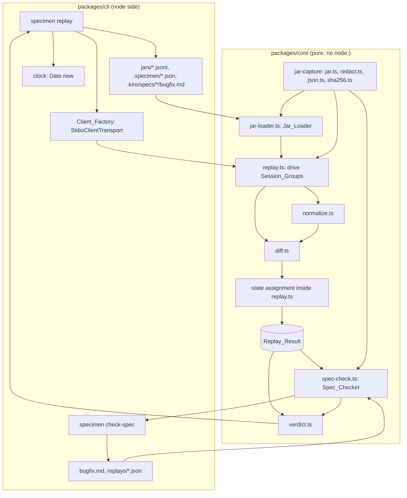
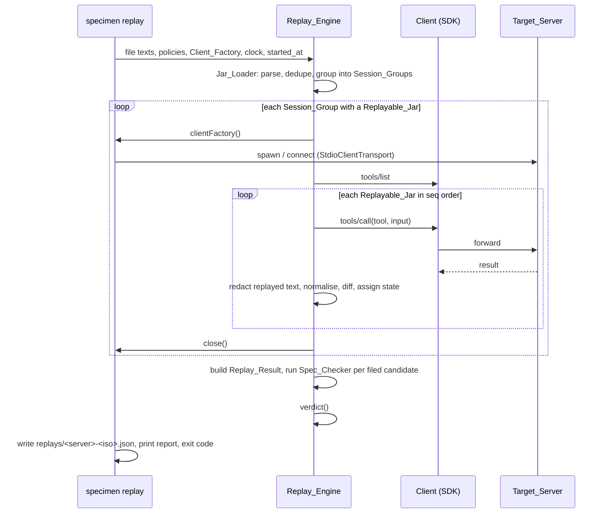

# Design Document

## Overview

The replay engine takes the jars recorded by jar-capture and a changed MCP server, and answers one question deterministically: did any recorded call come back different, and if so, is the break written up as a bugfix spec yet. The engine has four moving parts, all pure functions in `packages/core`: a Jar_Loader that turns jar text into Jar_Lines and Spoiled_Lines, a replay loop that drives a real MCP SDK client against a real server, a normalise/diff pair that compares two response bodies field by field, and a verdict function that folds jar states, spoiled counts and filed bugfix specs into one SHIP/HOLD decision. A fifth pure function, the Spec_Checker, decides whether a bugfix spec counts as filed for a given jar. `packages/cli` wires these to `specimen replay` and `specimen check-spec`: it spawns servers, reads and writes files, holds the clock, and calls into `packages/core` for every decision.

This spec reuses jar-capture's Jar_Schema (`packages/core/src/jar.ts`), Canonical_JSON and `sha256Hex` (`json.ts`, `sha256.ts`), the redaction functions and `DEFAULT_REDACT_CONFIG` (`redact.ts`, `scan.ts`), and `validSessionId`/payload conventions (`payload.ts`). It adds no second definition of any of these. New core modules follow the same no-`node:`, zod-at-the-boundary, pure-function style already established by `firewall.ts` and `manifest.ts`.

### Research findings that shape the design

| Finding | Source | Consequence |
|---|---|---|
| `createServer(version: Version, opts?: InnOptions): McpServer` already exists and takes no transport. | `servers/hollow-inn/src/index.ts` | The browser cabinet and in-process tests build a `Client_Factory` with `InMemoryTransport` directly against `createServer`. No new server wiring is needed for v1/v2. |
| The CLI's `--server "<cmd>"` is an arbitrary shell command (e.g. `npx tsx servers/hollow-inn/src/main.ts v2`), not a version flag. | requirements.md Requirement 10 criteria 1-3 | `packages/cli` owns a `StdioClientTransport`-based `Client_Factory` that splits and spawns that command. `packages/core` never knows about process spawning; it only receives a `Client_Factory` function. |
| `jarLineSchema` already has `redacted`, `text_redacted`, `response_length`, `unpaired` fields and `isJarPointer` restricts pointers to `/input...` and `/response...`. | `packages/core/src/jar.ts` | The Replay_Engine reuses `isJsonResponse`, `jarLineSchema`, and the existing pointer convention unchanged; Requirement 2 criteria 18-19 (excluding redacted pointers from comparison) strip the `/response` prefix the same way jar-capture used it when redacting. |
| `redactResponse`/`compileRedact`/`MARKER`/`DEFAULT_REDACT_CONFIG` already implement span-preserving JSON redaction and hash/text modes. | `packages/core/src/redact.ts` | Requirement 6 criterion 8 (redact replayed output before writing) and Requirement 2 criteria 22-23 (compare Hashed_Jar / `text_redacted` jars) call these functions directly; no new redaction logic is written. |
| `scanJson` keeps duplicate object members and reports exact spans; `canonicalJson` already treats `__proto__`/`constructor` as ordinary keys by building text through concatenation rather than property assignment. | `packages/core/src/scan.ts`, `json.ts` | The new `normalize.ts` and `diff.ts` modules copy this same walking style (plain recursion over parsed values, `Object.keys` iteration, never assigning through `obj[key] = ...` when `key` is attacker-controlled) so Requirement 12 criterion 8 holds without new code paths. |
| No `.specimen/volatile.json` or `.specimen/replay.json` exists yet in the repo; only `.specimen/redact.json` does. | workspace listing | This spec ships both default files (`.specimen/volatile.json` with the required globs, and the default empty-list `replay.json` is deliberately *not* shipped, since Requirement 2 criterion 14 requires a missing file to mean nothing is allowed). |
| The repo's zod version is zod 4 (`z.strictObject`, `z.iso.datetime`), matching jar-capture's usage. | `packages/core/src/jar.ts`, `redact.ts` | All new schemas (`Replay_Policy`, `Volatile_Policy`, `Replay_Result`, `Quarantine_File`, pointer/Repro_Block schemas) use the same zod 4 API for consistency. |

### Key design decisions

1. **One `Client_Factory` seam, two implementations.** `packages/core`'s replay loop takes `(clientFactory, fileTexts, policies, clock, startedAt)` and never imports `node:` anything. `packages/cli` implements the factory with `StdioClientTransport` spawning `--server "<cmd>"` as a real child process (no shell, split by quote-aware whitespace). Tests and the future browser cabinet implement the same factory shape with `InMemoryTransport` directly against `createServer("v1"|"v2")`. Both go through the identical MCP SDK `Client`, so no path mocks the protocol.
2. **Bodies are compared before the Hashed_Jar/text_redacted special cases, after redaction is reapplied identically.** Requirement 2 criteria 22-23 need the *replayed* text run back through the same redaction the jar-capture hook used on the original, so a secret that differs between runs doesn't manufacture a false rattle. The replay loop re-redacts the replayed text with the shipped `Compiled` redact config before it ever reaches `diff`, mirroring the hook's own order (redact first, compare second).
3. **Diff is structural and recursive, not a generic deep-diff library.** The path-aware rules (Id_Key array matching, rename suspicion by factor-of-ten, type-vs-value precedence, RFC 6901 escaping) are specific enough that a hand-written recursive `diff(a, b): Change[]` is simpler to make correct and auditable than configuring a third-party differ, and it keeps the "no `node:` import" and determinism guarantees trivially true by construction.
4. **The verdict function is the single source of truth for SHIP/HOLD**, taking no file paths, no clock and no network — only the already-computed `Result_Entry[]`, a spoiled count, a tool list and a set of filed ids. The CLI, a later Stop gate, and the cabinet all call this one function so the decision can never drift between surfaces (Requirement 5 criterion 19).
5. **The Spec_Checker reads only `Replay_Result.jars`,** never `verdict`/`red`/`filed`/`covered`/`reason`, so filing a spec cannot become self-referential (a spec could not "pass because the verdict already says covered"). This also makes `check-spec` usable standalone against an old Replay_Result file.

## Architecture



Replay data flow for one run:



### Repository layout (additions)

```
packages/core/src/
  jar-loader.ts     Jar_Loader: loadJars(texts) -> {lines, spoiled}; loadPending(text) -> {entries, spoiled}
  policy.ts         replayPolicySchema, volatilePolicySchema, resolvePointerGlob, isAllowedOrWatched
  normalize.ts       normalize(body, volatilePolicy) -> {value, ignored}
  diff.ts           diff(a, b) -> Change[]; idKeyOf; renameSuspicion helpers
  replay.ts         replaySessionGroups(...), buildReferenceCode (shared with spec-check), ReplayEngineArgs
  replay-result.ts  replayResultSchema, resultEntrySchema, quarantineFileSchema, buildReport
  verdict.ts        verdict(args) -> VerdictResult
  spec-check.ts      checkSpec(text, jarId, resultJars) -> "pass" | Failure[]
  reference.ts      referenceOf(resultEntry) -> ReferenceElement[]  (Requirement 8)
  index.ts          re-exports (extended)
packages/cli/src/
  replay/
    client-factory.ts   stdio Client_Factory, command splitting, timeout wiring
    load.ts             reads jars/*.jsonl, .specimen/pending.jsonl, policy files, calls jar-loader.ts
    write.ts            writes replays/<server>-<iso>.json, Quarantine_File, report text
    spec-files.ts       reads .kiro/specs/*/bugfix.md, calls spec-check.ts, computes filed ids
  replay.ts             `specimen replay` command (commander)
  check-spec.ts         `specimen check-spec` command (commander)
.specimen/
  volatile.json         shipped default Volatile_Policy
replays/                 Replay_Result output directory (created on demand)
```

### How `--server` becomes a connected client

`packages/cli/src/replay/client-factory.ts` exports `makeStdioClientFactory(cmd: string, timeoutMs: number): ClientFactory`. It splits `cmd` by whitespace honouring single/double quotes (the same quoting rule the requirements specify for both `--server` and `--baseline`), then on each call constructs a fresh `StdioClientTransport({ command, args, cwd: workspaceRoot, stderr: "pipe", env: process.env })`, pipes and discards stderr, and connects a new SDK `Client` with the per-call timeout from Requirement 1 criterion 10 passed as the SDK request timeout option. `close()` tears down the transport and lets the child process exit. This is the only file in the entire feature that imports `node:child_process`/`node:process` for spawning; `packages/core` never does.

The in-process test and future cabinet factory is the mirror image: `makeInMemoryClientFactory(version: Version)` calls `createServer(version)` from `servers/hollow-inn/src/index.ts`, builds a linked pair of `InMemoryTransport`s, and connects a real SDK `Client` to one end while the `McpServer` listens on the other — still the real SDK on both sides, per the tech rule against protocol mocks.

## Components and Interfaces

All `packages/core` functions below are pure: no `Date.now()`, no `Math.random()`, no network, no `node:` import, no mutation of inputs.

### core/jar-loader.ts

```ts
export type SpoiledLine = { file: string; line: number; reason: string };

/** Mirrors jar-capture's JarError kinds plus the two loader-only reasons. */
export type LoaderResult = { lines: JarLine[]; spoiled: SpoiledLine[] };

/**
 * Parses every jar file text with the existing jarLineSchema-based readJar (jar-capture),
 * then removes duplicates: a later Jar_Line whose id equals an earlier one, or whose
 * (session_id, seq) equals an earlier one, becomes a Spoiled_Line with reason "duplicate id"
 * or "duplicate seq" instead of a returned Jar_Line. "Earlier" means earlier by file name
 * in code-unit order, then by line number, matching the order `files` is given in.
 */
export function loadJars(files: { file: string; text: string }[]): LoaderResult;

export type PendingSpoiled = { file: ".specimen/pending.jsonl"; line: number; reason: string };
export type PendingResult = { entries: PendingEntry[]; spoiled: PendingSpoiled[] };

/** Parses the Pending_File. Every line is 1-based; an invalid line is reported and skipped. */
export function loadPending(text: string): PendingResult;

/**
 * Orphan_Entries: valid Pending_Entries whose (session_id, seq) matches no valid Jar_Line.
 */
export function findOrphans(entries: PendingEntry[], jarLines: JarLine[]): PendingEntry[];

export type SessionGroup = { sessionId: string; members: GroupMember[] };
export type GroupMember =
  | { kind: "jar"; line: JarLine }
  | { kind: "orphan"; entry: PendingEntry };

/**
 * Groups by session_id, orders groups ascending by the lowest seq in the group (ties by
 * session_id in code-unit order), and orders members within a group ascending by seq.
 */
export function groupBySession(lines: JarLine[], orphans: PendingEntry[]): SessionGroup[];
```

`loadJars` calls jar-capture's `readJar` per file (never reimplementing jar parsing), prefixes each `JarError` with its file name, and then applies the duplicate-detection pass described above across *all* files combined, in the file order the caller supplies — which `packages/cli` guarantees is code-unit order per Requirement 1 criterion 1.

### core/policy.ts

```ts
export const replayPolicySchema = z.strictObject({
  allow: z.array(z.string()),
  watch: z.array(z.string()),
});
export type ReplayPolicy = z.infer<typeof replayPolicySchema>;

export const volatilePolicySchema = z.strictObject({
  volatile: z.array(z.string()),
});
export type VolatilePolicy = z.infer<typeof volatilePolicySchema>;

export type ToolDecision = "allowed" | "watched" | "both" | "skipped";
/** allowed ∪ watch decide replay; a tool in both lists is replayed once (Requirement 2.24). */
export function decideTool(tool: string, policy: ReplayPolicy): ToolDecision;

/** True when `glob` is a syntactically valid RFC 6901 pointer with `*` wildcard segments. */
export function isPointerGlob(glob: string): boolean;

/** Matches a concrete RFC 6901 pointer against a Pointer_Glob, `*` matching one segment. */
export function matchesGlob(pointer: string, glob: string): boolean;

export const SHIPPED_VOLATILE_POLICY: VolatilePolicy; // { volatile: ["/created_at", "/bookings/*/created_at"] }
```

### core/normalize.ts

```ts
export type Body = Json | string; // string for a non-JSON response

/** Concrete RFC 6901 pointers removed, for the Ignored_List. */
export type NormalizeResult = { value: Body; removed: string[] };

/**
 * For a JSON Body: removes every value whose pointer matches a Pointer_Glob of the policy
 * (array removals reindex remaining elements), leaving a Body unchanged when nothing
 * matches. For a non-JSON Body: replaces "\r\n" with "\n" and returns no removed pointers.
 * Numbers are compared as parsed JSON numbers, so "425.00" and 425 are equal inputs to this
 * function once both are parsed — the literal-preserving text lives only in diff's non-JSON
 * line mode and in reference.ts, never in normalize.
 */
export function normalize(body: Body, policy: VolatilePolicy): NormalizeResult;
```

`normalize` walks the parsed value with a plain recursive function (array `.map`, `Object.keys` iteration building a fresh object), matching glob segments one at a time against the current path so `*` always consumes exactly one path segment and literal segments require an exact RFC 6901-unescaped match. This directly gives idempotence (removing an already-absent path is a no-op) and the empty-policy invariant (no glob to match, nothing removed).

### core/diff.ts

```ts
export type ChangeKind = "removed" | "added" | "value" | "type" | "length";
export type Change = {
  path: string;            // RFC 6901 pointer, "" for the whole body
  kind: ChangeKind;
  was?: Json;
  now?: Json;
  note?: string;           // rename suspicion or depth-limit note
};

/**
 * Structural diff of two normalised Bodies. Pure, deterministic, no node: import. Handles:
 *  - object members: removed / added / value / type, in that kind order for equal paths
 *  - scalars: value (same type) or type (different type), no descent on type mismatch
 *  - arrays: length Change on length mismatch; Id_Key matching when available, else
 *    index-by-index; a reordering of Id_Key-matched members' key sets yields one value
 *    Change carrying the two ordered key lists rather than per-element noise
 *  - rename suspicion: a removed numeric path and an added numeric sibling whose key is
 *    the removed key plus "_<suffix>", where now = was * 10^n (n in 1..3) computed in
 *    exact decimal text arithmetic, annotates the added Change; ties broken by lowest n
 *    then lowest code-unit path; a non-numeric or different-stem sibling never gets a note
 *  - non-JSON bodies: line-by-line value Changes at "/line/<n>", one length Change at "/line"
 *  - depth limit: a Body nested beyond 1000 levels yields one type Change with note
 *    "depth limit 1000" at the path where the limit was reached, instead of recursing further
 * Paths are RFC 6901, `~`/`/` escaped. Results are sorted by path (code-unit order), then by
 * kind in the fixed order removed, added, value, type, length for equal paths.
 */
export function diff(was: Json, now: Json): Change[];

/** The Id_Key of an array of objects, per the selection rule (id first, else lowest *_id
 *  key by code-unit order, requiring string-form-unique values present in every element),
 *  or undefined when no key qualifies. Exported for reference.ts's Value_Span resolution. */
export function idKeyOf(elements: Json[]): string | undefined;
```

Internally `diff` is a small set of mutually recursive helpers (`diffValue`, `diffObject`, `diffArrayByIndex`, `diffArrayById`, `renameNotes`) over plain parsed `Json`, never touching raw text — raw-text literal preservation for the Reference is a separate, later step in `reference.ts` that re-reads `response_text` by path. The exact-decimal-arithmetic rule for rename detection parses each number's *shortest round-tripping decimal text* (`String(n)`) as `{sign, digits, exponent}` and checks `now_digits == was_digits` with `now_exponent - was_exponent` in `1..3`, rather than doing `was * Math.pow(10, n) === now` in binary floating point, so `4.35 * 100` is recognised as `435` exactly.

### core/replay.ts

```ts
export type Clock = () => number; // monotonic milliseconds

export type ClientFactory = () => Promise<{ client: Client; close: () => Promise<void> }>;

export type ReplayEngineArgs = {
  jarFiles: { file: string; text: string }[];
  pendingText: string | undefined;
  replayPolicy: ReplayPolicy;
  volatilePolicy: VolatilePolicy;
  redactConfig: Compiled;           // from packages/core/src/redact.ts
  strict: boolean;
  clientFactory: ClientFactory;
  clock: Clock;
  startedAt: string;                // ISO, supplied by packages/cli
  serverLabel: string;
  timeoutMs: number;
  baselineFactory?: ClientFactory;  // for schema_diff only
};

export type EngineOutcome = {
  resultEntries: ResultEntry[];     // see replay-result.ts
  spoiled: SpoiledLine[];
  toolsListed: string[];
  schemaDiff: SchemaDiff;
};

/** Drives every Session_Group, assigns states, and builds the Result_Entry list. Never
 *  writes to jars/, never retries at the protocol level beyond the SDK's own behaviour. */
export async function replay(args: ReplayEngineArgs): Promise<EngineOutcome>;
```

State assignment inside `replay` applies the fixed precedence order (unsealed, skipped, cracked, then preserved-or-rattled by diff) as a small decision table evaluated per Jar_Line/Orphan_Entry before any network call is made for that item, so an item that will not be called never is. The Hashed_Jar and `text_redacted` branches call `redactResponse`/`compileRedact` from jar-capture on the *replayed* text with the same `Compiled` config, then compare the resulting `sha256:` text or redacted text directly, bypassing `normalize`/`diff` for those two cases as Requirement 2 criteria 22-23 specify.

### core/replay-result.ts

```ts
export const resultEntrySchema = z.strictObject({
  id: z.string().nullable(),
  session_id: z.string(),
  seq: z.number().int(),
  tool: z.string(),
  state: z.enum(["preserved", "rattled", "cracked", "unsealed", "skipped"]),
  input: jsonSchema.nullable(),
  response_text: z.string().nullable(),
  changes: z.array(changeSchema),
  compatible: z.array(changeSchema),
  ignored: z.array(z.string()),
  replayed_text: z.string().nullable(),
  replayed: jsonSchema.nullable(),
  reason: z.string().optional(),
  error: z.string().optional(),
  ms: z.number().int().min(0),
});
export type ResultEntry = z.infer<typeof resultEntrySchema>;

export const replayResultSchema = z.strictObject({
  v: z.literal(1),
  server: z.string(),
  started_at: z.iso.datetime({ offset: true }),
  strict: z.boolean(),
  jars: z.array(resultEntrySchema),
  spoiled: z.array(z.strictObject({ file: z.string(), line: z.number().int(), reason: z.string() })),
  counts: z.strictObject({
    preserved: z.number().int(), rattled: z.number().int(), cracked: z.number().int(),
    unsealed: z.number().int(), skipped: z.number().int(),
  }),
  schema_diff: z.strictObject({
    tools_removed: z.array(z.string()), tools_added: z.array(z.string()),
    input_schema_changed: z.array(z.string()),
  }),
  verdict: z.enum(["SHIP", "HOLD"]),
  red: z.number().int(), filed: z.number().int(), covered: z.boolean(),
  reason: z.string(),
  coverage: z.strictObject({
    compared: z.number().int(), tools_compared: z.array(z.string()),
    tools_listed: z.array(z.string()), tools_unrecorded: z.array(z.string()),
  }),
});
export type ReplayResult = z.infer<typeof replayResultSchema>;

export const quarantineFileSchema = z.strictObject({
  v: z.literal(1),
  items: z.array(z.strictObject({
    id: z.string().nullable(), session_id: z.string(), seq: z.number().int(),
    tool: z.string(), reason: z.string(),
  })),
});

/** Builds the text report lines of Requirement 10 criteria 8-10 from a ReplayResult. */
export function buildReport(result: ReplayResult): string[];

/** "N jars compared · T of K tools · not recorded: a, b" (or "none", or "1 jar compared"). */
export function coverageString(coverage: ReplayResult["coverage"]): string;
```

### core/verdict.ts

```ts
export type VerdictArgs = {
  entries: ResultEntry[];
  spoiledCount: number;
  toolsListed: string[];
  filedIds: ReadonlySet<string>;
};

export type VerdictResult = {
  verdict: "SHIP" | "HOLD";
  reason: string;
  red: number;
  filed: number;
  covered: boolean;
  coverage: ReplayResult["coverage"];
};

/**
 * The single source of truth for SHIP/HOLD (Requirement 5 criterion 19). Reads no clock, no
 * randomness, no network. SHIP iff at least one Compared_Jar exists, no jar is rattled,
 * cracked, unsealed or skipped, and spoiledCount is 0 (criterion 2). Reason parts are joined
 * "; " in the fixed order: no jars, red, not replayed, quarantined, spoiled.
 */
export function verdict(args: VerdictArgs): VerdictResult;
```

### core/spec-check.ts

```ts
export type Failure = { code: string; message: string };

/**
 * Validates a Bugfix_Spec's text against one jar id and the `jars` entries of a
 * Replay_Result. Reads only `resultJars`, never verdict/red/filed/covered/reason.
 * Short-circuits to a single failure for not_red / jar_unknown; otherwise accumulates every
 * failing check (headings, when_then, shall, shall_continue, jar_id token match, repro block
 * presence/parseability, repro verbatim-modulo-formatting equality, paths-in-section,
 * unchanged_jar reference, expected_reference).
 */
export function checkSpec(text: string, jarId: string, resultJars: ResultEntry[]): "pass" | Failure[];
```

`checkSpec` locates Sections by scanning markdown heading lines (`^#{1,6}\s+<name>\s*$`) and slicing to the next heading of equal-or-higher level, locates the Marker_Pair and the single `json specimen-repro` fenced block between them, and compares the Repro_Block entry for `jarId` against the matching `ResultEntry` using `canonicalJson` equality (jar-capture) for `input`/`replayed`/`changed_paths`, and either `canonicalJson` equality (if `response_text` is a JSON_Response per `isJsonResponse`) or exact string equality otherwise — reusing jar-capture's existing predicate rather than re-deriving it.

### core/reference.ts

```ts
export type ReferenceElement =
  | { kind: "path-literal"; path: string; literal: string }  // e.g. "/total" + "425.00"
  | { kind: "path"; path: string }
  | { kind: "key"; key: string }                             // last segment of a removed array element
  | { kind: "tool"; tool: string };

/**
 * Derives the Reference (Requirement 8) from a ResultEntry's changes/state/tool/response_text
 * only, never from Bugfix_Spec prose. Resolves a Value_Span by locating the Change's path in
 * the jarred response_text through scanJson (jar-capture), so the literal text (e.g. "425.00")
 * is copied byte for byte rather than re-rendered from the parsed `response` number.
 */
export function referenceOf(entry: ResultEntry): ReferenceElement[];

/** Renders a ReferenceElement as the substring(s) the Section "Expected Behavior (Correct)"
 *  must contain, for use by spec-check.ts's expected_reference check. */
export function referenceSubstrings(ref: ReferenceElement): string[];
```

`referenceOf` reuses `idKeyOf` from `diff.ts` to resolve an array-element path segment back to the matching element when computing a Value_Span through an Id_Key-ed array, and reuses jar-capture's `scanJson` to find the exact character span of the jarred value at a given path so the literal text is never reconstructed from the parsed number.

### cli/replay.ts and cli/check-spec.ts (commander wiring)

```ts
program
  .command("replay")
  .requiredOption("--server <cmd>")
  .option("--jars <dir>")
  .option("--baseline <cmd>")
  .option("--strict", false)
  .option("--json", false)
  .option("--out <file>")
  .option("--timeout <ms>", "10000")
  .action(runReplay);

program
  .command("check-spec <bugfixMd>")
  .requiredOption("--jar <id>")
  .option("--replay <file>")
  .action(runCheckSpec);
```

`runReplay` (in `packages/cli/src/replay.ts`) resolves `Workspace_Root`, reads and zod-validates every `.specimen/*.json` policy file (exiting 2 on a strict-schema failure per Requirement 2 criterion 15), reads `jars/*.jsonl` and `.specimen/pending.jsonl`, builds the `Client_Factory`(ies), calls `replay()`, reads every `.kiro/specs/*/bugfix.md` whose text has a Whole_Token_Match of a Red_Jar id and runs `checkSpec` on each (Requirement 9), calls `verdict()` with the resulting filed id set, assembles and zod-validates the `ReplayResult`, writes it and the `Quarantine_File`, prints the report or JSON, and exits with the code the Verdict/covered combination dictates. `runCheckSpec` selects the newest matching `replays/*.json` file when `--replay` is absent (by parsing the 24-character ISO suffix out of each filename, a small pure helper `selectLatestReplay(names: string[]): string | undefined` in `packages/core` so it can be property-tested), validates it against `replayResultSchema`, calls `checkSpec`, and prints `PASS`/`FAIL` lines.

## Data Models

### Result_Entry example (preserved quote jar)

```json
{
  "id": "SPC-0007", "session_id": "4f1c9e", "seq": 2, "tool": "quote", "state": "preserved",
  "input": {"room_id": "r-04", "nights": 2},
  "response_text": "{\"room_id\":\"r-04\",\"nights\":2,\"nightly\":212.50,\"total\":425.00,\"currency\":\"USD\"}",
  "changes": [], "compatible": [], "ignored": [],
  "replayed_text": "{\"room_id\":\"r-04\",\"nights\":2,\"nightly\":212.50,\"total\":425.00,\"currency\":\"USD\",\"created_at\":\"2026-11-25T00:00:00Z\"}",
  "replayed": {"room_id": "r-04", "nights": 2, "nightly": 212.5, "total": 425, "currency": "USD", "created_at": "2026-11-25T00:00:00Z"},
  "reason": undefined, "error": undefined, "ms": 42
}
```

`ignored` holds `/created_at` because the shipped Volatile_Policy removed it before `diff` ran, so `changes` is empty and the state is `preserved` even though the raw replayed text grew a field.

### Result_Entry example (rattled, rename suspicion)

```json
{
  "id": "SPC-0012", "session_id": "9a01bb", "seq": 1, "tool": "quote", "state": "rattled",
  "changes": [{"path": "/total_cents", "kind": "added", "now": 42500, "note": "suspected rename from /total ×100"}],
  "compatible": [], "ignored": [], "ms": 15
}
```

### Replay_Result file example (top level)

```json
{
  "v": 1, "server": "npx-tsx-servers-hollow-inn-src-main-ts-v2", "started_at": "2026-11-25T00:00:00.000Z",
  "strict": false, "jars": ["... Result_Entry ..."], "spoiled": [],
  "counts": {"preserved": 5, "rattled": 1, "cracked": 1, "unsealed": 0, "skipped": 0},
  "schema_diff": {"tools_removed": [], "tools_added": [], "input_schema_changed": []},
  "verdict": "HOLD", "red": 2, "filed": 0, "covered": false,
  "reason": "2 rattled, 1 cracked",
  "coverage": {"compared": 7, "tools_compared": ["quote", "search_rooms", "cancel_booking"], "tools_listed": ["quote", "search_rooms", "book_room"], "tools_unrecorded": ["book_room"]}
}
```

### Files

| Path | Owner | Format |
|---|---|---|
| `replays/<server>-<iso>.json` | `specimen replay` | `ReplayResult`, pretty-printed JSON, trailing newline |
| `.specimen/quarantine.json` | `specimen replay` | `Quarantine_File`, replaced every run |
| `.specimen/replay.json` | author | `Replay_Policy`; missing ⇒ empty `allow`/`watch` |
| `.specimen/volatile.json` | shipped default, author may override | `Volatile_Policy` |
| `.kiro/specs/<name>/bugfix.md` | `specimen file` (out of scope) | markdown read by `check-spec` |

All paths are resolved against the Workspace_Root, matching jar-capture's `findWorkspaceRoot` convention (Requirement 12 criterion 18).

## Correctness Properties

*A property is a characteristic or behavior that should hold true across all valid executions of a system — essentially, a formal statement about what the system should do. Properties serve as the bridge between human-readable specifications and machine-verifiable correctness guarantees.*

A reflection pass against the prework analysis removed several redundant splits before the list below was finalised. The diff identity, determinism and removed-added invariant criteria from Requirement 4 are folded into the general structural-diff property rather than generated as separate behaviours, since they are universal corollaries of the same diff function. The normalise idempotence and empty-policy invariants from Requirement 3 are stated directly within the normalisation property rather than split out. The Error_Result and protocol-failure cracked rules from Requirements 1 and 2 are one state-assignment decision and are combined with the state-precedence rule and the unsealed, skipped and allow-watch rules, since precedence only means something when every contributing rule is exercised together. The Hashed_Jar and text_redacted comparison rules from Requirement 2 share the same redact-then-compare shape and are combined into one property. The SHIP rule and the red, filed, covered and coverage computations from Requirement 5 are one pure function and are combined into one property; the reason-string composition and ordering rules are kept separate because they are a distinct formatting concern with their own edge cases that deserve independent generators. The rename-suspicion criteria from Requirement 4 are combined into a single property covering both the positive detection rule and its required negative cases, including the 100 versus "100" and unrelated-stem examples.

### Property 1: Jar_Loader partitions valid lines from Spoiled_Lines

*For any* set of jar file texts and any single-line mutation of one line (invalid JSON, a failing field, an added unknown field, a blank line before the end, or a missing final newline — reusing jar-capture's own mutation shapes), `loadJars` returns a Spoiled_Line for exactly the mutated line with a matching file name and 1-based line number, and returns every other line unaffected and unduplicated.

**Validates: Requirements 1.2, 1.3**

### Property 2: Duplicate ids and duplicate (session_id, seq) pairs are spoiled, not replayed

*For any* list of otherwise-valid Jar_Lines in which a later line repeats an earlier line's `id`, or repeats an earlier line's `session_id` and `seq`, `loadJars` keeps only the earliest occurrence as a returned Jar_Line and reports every later occurrence as a Spoiled_Line with reason "duplicate id" or "duplicate seq", where "earlier" is determined by the file-name-then-line-number order of the input.

**Validates: Requirements 1.19**

### Property 3: Session grouping preserves membership and fixes order

*For any* list of Jar_Lines and Orphan_Entries, `groupBySession` returns one group per distinct `session_id` containing exactly its members, with groups ordered ascending by the lowest `seq` in the group (ties broken by `session_id` code-unit order) and members within each group ordered ascending by `seq`, regardless of the input order.

**Validates: Requirements 1.4**

### Property 4: Replayed text and parsed response are derived consistently from a tools/call result

*For any* `tools/call` result whose `content` array holds zero or more items of which some are `text` items, the replayed text equals the concatenation of the `text` items' text (or `""` when there are none), and the stored `replayed` value equals `JSON.parse(replayedText)` when that text is a JSON_Response (by `isJsonResponse`) and `null` otherwise.

**Validates: Requirements 1.8, 1.9**

### Property 5: Normalisation is idempotent and a no-op under an empty policy

*For any* JSON value and Volatile_Policy, normalising twice produces a value deep-equal to normalising once. *For any* JSON value, normalising with an empty Volatile_Policy returns a value deep-equal to the input. *For any* JSON value and Pointer_Glob that matches nothing in it, the value is unchanged. *For any* array element removed by a matching glob, the remaining elements are reindexed with no gap.

**Validates: Requirements 3.1, 3.2, 3.3, 3.6, 3.8, 3.9**

### Property 6: Non-JSON normalisation only touches line endings

*For any* string, `normalize` on a non-JSON Body returns that string with every `\r\n` replaced by `\n` and no other change, and this transform is idempotent.

**Validates: Requirements 3.10**

### Property 7: Structural diff is identity-preserving, deterministic, and locates every field-level difference

*For any* JSON value, `diff(v, v)` returns `[]` (identity). *For any* two JSON values, calling `diff` twice with the same arguments returns deep-equal lists (determinism), and no Change is produced that contradicts the kind rules: every `removed` path is present in `was` and absent in `now`, every `added` path is present in `now` and absent in `was`, every `value`/`type` Change is at a path present and of comparable or differing type in both, and every array `length` Change reflects an actual length difference. Results are sorted by path then by the fixed kind order for equal paths, with every path a validly RFC-6901-escaped pointer.

**Validates: Requirements 4.1, 4.2, 4.3, 4.4, 4.5, 4.6, 4.10, 4.11, 4.17, 4.18, 4.19, 4.20**

### Property 8: Rename suspicion fires only for a matching numeric stem and factor, never otherwise

*For any* object with a `removed` Change carrying a numeric `was` at a path ending in key `k`, and an `added` Change carrying a numeric `now` at a sibling path whose key is `k` followed by `_<suffix>`, where `now` equals `was` times `10^n` for some integer `n` in 1 to 3 computed from the two numbers' exact decimal text (not binary floating-point multiplication), `diff` annotates that `added` Change with "suspected rename from `<removed path>` ×`10^n`" and treats the `removed` Change as breaking; when several added candidates match one removed path, only the one with the lowest `n` (ties broken by lowest code-unit path) is annotated. *For any* such pair where the sibling key has a different stem, or where `now` is a string rather than a number (so `100` vs `"100"` yields only a `type` Change), or where no power-of-ten multiple relates the two decimal values, no rename note is added.

**Validates: Requirements 4.12, 4.13, 4.14, 4.21, 4.22, 4.23, 4.24**

### Property 9: Id_Key array matching reports stable per-element changes and one length Change

*For any* two arrays of objects that each have a qualifying Id_Key with the same name (or one array is empty), elements are matched by that key's string-form value; a missing matched element is reported as `removed` at `<array path>/<key value>` together with one `length` Change at the array path, an extra element is reported as `added` the same way, and matched elements are diffed field by field below that path. *For any* two arrays without a shared-name Id_Key, elements are compared index by index, with any extra trailing elements reported as `removed` or `added` at `<array path>/<index>` and a `length` Change when lengths differ. *For any* Id_Key-matched arrays whose matched elements' key sets appear in a different order, the result is one `value` Change at the array path carrying the two ordered key lists, not a cascade of per-key Changes.

**Validates: Requirements 4.7, 4.8, 4.9**

### Property 10: Jar state assignment follows a fixed precedence and is total

*For any* Jar_Line or Orphan_Entry and any combination of {unpaired flag, Orphan status, Allowed/Watched/neither tool membership, tool present or absent from tools/list, a protocol-level failure or Error_Result occurring, a diff result}, exactly one of `unsealed`, `skipped`, `cracked`, `preserved`, `rattled` is assigned, chosen by testing in that order (unsealed, skipped, cracked, then diff-based) and stopping at the first that applies; an Error_Result against a non-Error_Shaped jarred response is always `cracked` with no diff performed, while an Error_Result against an Error_Shaped jarred response or any non-error result is always compared by diff; a tool named in both `allow` and `watch` is treated identically to one named in only one of them.

**Validates: Requirements 1.14, 1.15, 2.1, 2.7, 2.10, 2.11, 2.13, 2.14, 2.21, 2.24**

### Property 11: Redacted-at-capture jars compare the re-redacted replayed text, not the raw text

*For any* two raw response texts and a `Compiled` redact config, when the jar is a Hashed_Jar, hashing both texts through the same config's hash-mode redaction and comparing the two `sha256:` texts for equality gives the same preserved/rattled outcome as comparing the texts directly would for an unhashed jar, and a mismatch produces exactly one `value` Change at `/response_text` carrying both `sha256:` texts. *For any* two raw texts and a config in `text_redacted` (non-hash) mode, applying the same pattern redaction to the replayed text before diffing it against the already-redacted jarred text never reports a Change caused solely by a secret value that differs between the two runs.

**Validates: Requirements 2.22, 2.23**

### Property 12: Excluded pointers never produce a Change and are always listed as ignored

*For any* Body pair and any set of `redacted` pointers beginning with `/response`, stripping the prefix and excluding each resulting path (and everything below it) from comparison means `diff` reports no Change at or below any excluded path, and every concrete pointer excluded this way, or removed by `normalize`, appears in the Ignored_List exactly once.

**Validates: Requirements 2.18, 2.19, 3.5**

### Property 13: The replay engine never calls a tool for a jar it will not compare

*For any* set of Jar_Lines whose states are determined by Property 10's precedence, every jar assigned `skipped` or `unsealed` results in no `tools/call` being issued for it, and the engine's overall tool-call count equals exactly the number of Replayable_Jars.

**Validates: Requirements 2.20**

### Property 14: The verdict is SHIP under exactly one rule, and is deterministic

*For any* list of Result_Entries, spoiled count, and filed id set, `verdict` returns `SHIP` if and only if at least one entry is `preserved`, `rattled` or `cracked` (a Compared_Jar exists), no entry is `rattled`, `cracked`, `unsealed` or `skipped`, and the spoiled count is 0; otherwise it returns `HOLD`. `red` always equals the count of `rattled` plus `cracked` entries, `filed` always equals the count of those whose id is in the filed id set, and `covered` is true if and only if the verdict is `HOLD`, at least one Compared_Jar exists, `red` is greater than 0, `filed` equals `red`, no entry is `unsealed` or `skipped`, and the spoiled count is 0. *For any* arguments, calling `verdict` twice returns deep-equal results.

**Validates: Requirements 5.1, 5.2, 5.9, 5.10, 5.11, 5.16, 5.17**

### Property 15: The HOLD reason is composed from present parts in a fixed order

*For any* combination of {zero or more rattled, zero or more cracked, zero or more skipped-tool names, zero or more quarantine reasons, a spoiled count}, the reason string includes a part for each condition that applies — "no jars" only when there are no entries and no spoiled lines; "N rattled"/"N cracked" (or the combined form) only when their counts are positive; "N not replayed: ..." listing the distinct skipped tools in code-unit order; one "N quarantined: `<reason>` — re-record the session" part per distinct quarantine reason, "orphan pre-event" preceding "unpaired post-event"; "N spoiled line(s)" with correct pluralisation — and joins exactly the applicable parts with "; " in the order no jars, red, not replayed, quarantined, spoiled.

**Validates: Requirements 5.3, 5.4, 5.5, 5.6, 5.7, 5.8**

### Property 16: Coverage is computed consistently from compared jars and the listed tools

*For any* set of Result_Entries and a tool list, `coverage.compared` equals the number of `preserved`/`rattled`/`cracked` entries, `coverage.tools_compared` equals the distinct tools of those entries that also appear in `coverage.tools_listed`, and `coverage.tools_unrecorded` equals the listed tools named by no valid Jar_Line, each rendered in code-unit order; `coverageString` renders these four numbers/lists into the fixed template, using "1 jar compared" only when `compared` is 1 and "none" only when `tools_unrecorded` is empty.

**Validates: Requirements 5.13, 5.14**

### Property 17: Written Replay_Results carry no unredacted secret and round-trip through their schema

*For any* valid `ReplayResult` whose replayed texts, Change values and error texts are passed through the Compiled redact config before assembly, no original (pre-redaction) value appears anywhere in the serialised result, and `replayResultSchema.parse(JSON.parse(JSON.stringify(result)))` is deep-equal to `result`.

**Validates: Requirements 6.8, 6.9, 6.14**

### Property 18: schema_diff is computed from two tool lists and never influences state or verdict

*For any* two `tools/list` results (each a list of `{name, inputSchema}`), `schema_diff.tools_removed`/`tools_added` equal the set differences of the tool names in code-unit order, and `tools_input_schema_changed` equals the names present in both whose `inputSchema` differ after Canonical_JSON normalisation. *For any* `ReplayResult`, changing only `schema_diff` while holding every `jars` entry and the spoiled count fixed never changes the output of `verdict`.

**Validates: Requirements 6.6, 6.7, 6.17**

### Property 19: The Spec_Checker never reads verdict-level fields and short-circuits correctly

*For any* `ReplayResult` whose `verdict`, `red`, `filed`, `covered` and `reason` fields are changed arbitrarily while `jars` is held fixed, `checkSpec` returns the same result for the same spec text and jar id. *For any* jar id absent from `jars`, `checkSpec` returns exactly the single failure `jar_unknown`. *For any* jar id present but whose entry's state is not `rattled` or `cracked`, `checkSpec` returns exactly the single failure `not_red`, regardless of the spec text's content.

**Validates: Requirements 7.1, 7.17, 7.18, 7.19**

### Property 20: Heading and keyword checks are scoped to their own Section

*For any* Bugfix_Spec text built from three Sections with independently chosen presence/absence of a `WHEN ... THEN the system` line in "Current Behavior (Defect)", a `SHALL` (not followed by " CONTINUE TO") line in "Expected Behavior (Correct)", and a `SHALL CONTINUE TO` line in "Unchanged Behavior (Regression Prevention)", each of `when_then`, `shall`, `shall_continue` fails if and only if its own Section lacks a qualifying line, and a qualifying line placed only in a different Section never satisfies the check. *For any* text missing a required Heading, the `headings` failure names exactly the missing heading(s), and `SPC-0004` is never matched as a Whole_Token_Match inside `SPC-00045`.

**Validates: Requirements 7.2, 7.3, 7.4, 7.5, 7.6**

### Property 21: The Repro_Block is required, parseable, and compared up to formatting only

*For any* Bugfix_Spec text, `repro_missing` fails if and only if there is not exactly one Marker_Pair enclosing exactly one valid-JSON `json specimen-repro` fenced block whose parsed array has an entry for the checked jar id. *For any* Repro_Block entry that differs from its Result_Entry only in object key order or inter-token whitespace, the repro check passes; *for any* entry that differs in a field's value (by Canonical_JSON inequality, or by exact string inequality for a non-JSON `response_text`), the check fails with `repro_not_verbatim` naming that field.

**Validates: Requirements 7.7, 7.8, 7.9, 7.10, 7.11**

### Property 22: The paths and unchanged-jar checks read the right Section and the right companion entries

*For any* jar whose `changes` carry a set of paths, the `paths` failure fires if and only if "Current Behavior (Defect)" is missing at least one of those paths as a substring, and it names exactly the missing ones. *For any* Replay_Result that does or does not contain a `preserved` entry sharing the checked jar's tool, `unchanged_jar` fails unless "Unchanged Behavior (Regression Prevention)" contains a Whole_Token_Match of such a preserved entry's id when one exists, or the literal text "no preserved jar" when none does.

**Validates: Requirements 7.12, 7.13**

### Property 23: The Reference is derived only from the Result_Entry and matched only by its exact elements

*For any* Result_Entry, `referenceOf` returns elements built only from its `changes`, `state`, `tool` and `response_text` — never from spec prose — following the rules: a `value`/`type` Change at a non-empty path yields a path-plus-literal element whose literal is copied byte-for-byte from `response_text` at that path's location; a `removed` Change not collapsed by a sibling `length` Change yields a path-plus-literal element; a `length` Change with sibling `removed` elements under the same array path yields one `key` element per removed element's last path segment instead of their paths and literals; a `cracked` jar (tool missing, or a protocol failure, or an Error_Result) yields a single `tool` element and never includes the `error` text. `expected_reference` fails if and only if "Expected Behavior (Correct)" is missing at least one required substring of some Reference element, accepting only the literal decimal text as it appeared in `response_text` (e.g. accepting `425.00` and rejecting `425` or `425.0` as a match for that element).

**Validates: Requirements 8.1, 8.2, 8.3, 8.4, 8.5, 8.6, 8.7, 8.8, 8.9, 8.11, 8.12**

### Property 24: Filed ids are exactly those with at least one passing spec

*For any* list of (Bugfix_Spec text, jar id, pass-or-fail) triples grouped by jar id, the set of filed ids computed by the CLI's aggregation equals exactly the ids for which at least one triple passed, regardless of how many specs fail for that id or cite it at all.

**Validates: Requirements 9.2, 9.3, 9.5**

### Property 25: Replay result file selection picks the greatest ISO suffix deterministically

*For any* list of filenames, `selectLatestReplay` returns the one whose trailing 24-character `YYYY-MM-DDTHH-mm-ss.sssZ` suffix (before `.json`) is greatest in code-unit order among filenames that match the pattern, breaking ties by the greatest whole filename in code-unit order, and ignores every non-matching filename; it returns `undefined` only when no filename matches.

**Validates: Requirements 11.2**

### Property 26: Deeply nested bodies are bounded, not stack-overflowing

*For any* JSON value nested beyond the 1,000-level depth limit on either side, `diff` (and the `normalize` call that precedes it) returns a single `type` Change with the note "depth limit 1000" at the path where the limit was reached, rather than throwing or recursing without bound, and `__proto__`/`constructor` keys are always treated as ordinary object keys by both functions.

**Validates: Requirements 12.8, 12.9**

## Error Handling

| Condition | Behaviour | Requirement |
|---|---|---|
| `--server` missing/empty, unknown option, non-positive `--timeout`, unterminated quote | Usage message to STDERR, exit 2 | 10.4 |
| `.specimen/replay.json`, `volatile.json` or `redact.json` fails its strict schema, or a redact pattern is invalid/empty | Diagnostic naming the failing field/pattern index to STDERR, exit 2 | 2.15 |
| `.specimen/replay.json` missing | Treated as `{allow: [], watch: []}`, every jar `skipped` | 2.14 |
| `.specimen/volatile.json` missing | Built-in `SHIPPED_VOLATILE_POLICY` applied | 2.16 |
| `.specimen/redact.json` missing | jar-capture's `DEFAULT_REDACT_CONFIG` applied | 2.16 |
| `jars/` directory missing | Treated as empty; verdict HOLD "no jars" | 10.16 |
| `jars/` unreadable, or other operational error | Diagnostic to STDERR, exit 2 | 10.16 |
| Connect / `tools/list` / `tools/call` exceeds `--timeout` | Treated as a protocol-level failure; affected jar(s) `cracked` | 1.10, 2.8 |
| Target_Server cannot start, or connect/`tools/list` fails for a group | Every Replayable_Jar in that group `cracked`; existing `skipped`/`unsealed` entries keep their state | 2.9 |
| Transport error or closed connection mid-group | Every later Replayable_Jar in that group `cracked` with "session aborted after `<failure text>`"; not called | 1.16 |
| No Replayable_Jar exists anywhere | One Target_Server still started only for `tools/list`; on failure `tools_listed` is `[]` | 1.17 |
| `--baseline` cannot start or its `tools/list` fails | Diagnostic to STDERR, no Replay_Result written, exit 2 | 10.19 |
| Bugfix_Spec, Replay_Result, or `--jar`/`--replay` arguments invalid for `check-spec` | Diagnostic to STDERR, exit 2 | 11.5 |
| Spec_Checker finds failures | Every failure returned (not just the first), except `not_red`/`jar_unknown` short-circuits | 7.16, 7.18, 7.19 |

Known limits carried from the requirements: SHIP means only "replay clean on the recorded set." A redacted jar input replays with the marker in place of the original value, so the call may behave differently from the original and the engine cannot distinguish that from a real server change. A skipped call is not replayed, so later jars in its session may legitimately differ. The rename detector recognises only a numeric stem-plus-suffix rename scaled by a power of ten; other renames surface as one removed and one added path.

## Testing Strategy

**Tools.** `vitest` with `fast-check`, run by `npm test` at the repository root. Core property and unit tests live in `packages/core/test/*.test.ts`; CLI integration tests live in `packages/cli/test/*.test.ts`.

**Property tests.** Each of Properties 1-26 is implemented as one `fc.assert(fc.property(...))` with `numRuns >= 100`, tagged with a comment `Feature: replay-engine, Property N: <title>`. Generators build on jar-capture's existing JSON-value generators (including `__proto__`/`constructor` keys, astral characters, and formatted-number variants such as `425.00`, `1e2`, `-0.0`) plus new generators for: Jar_Line lists with controlled duplicate ids/seqs, Session_Group membership lists, Change lists with controlled removed/added numeric siblings (for the rename property's positive and required negative cases — same stem different type, different stem same factor, no factor relationship), arrays of objects with and without a shared Id_Key, Result_Entry lists with controlled state distributions, and markdown Bugfix_Spec texts assembled from Section fragments with independently toggled keyword lines.

**Unit and integration tests.**

- Negative diff-engine fixtures required explicitly: `100` vs `"100"` at the same path yields one `type` Change and no rename note; a removed numeric path with an added string sibling of the same stem yields no rename note; an unrelated removed/added pair with different stems whose values differ by `×10^n` yields no rename note (Requirement 13.3).
- `"total":425.00` in a jarred text compares equal to a replayed `425` (number identity, not text identity) with no Change (Requirement 13.4).
- A dropped Id_Key-matched array element is reported by its key together with one `length` Change (Requirement 13.5).
- Fixture evals E3b-E3e, E4, E6 exactly as specified in Requirement 13 (filed/covered interplay, empty jar set, all-skipped set, orphan and spoiled-line quarantine reasons, repro-block edit/reorder/missing-reference cases, the `/created_at`-only preserved case).
- End-to-end tests using the real MCP SDK `Client` over `InMemoryTransport` against `createServer("v1")` and `createServer("v2")` from `servers/hollow-inn/src/index.ts`, replaying the repository's jars in a temporary workspace copy and asserting the documented v1 (`preserved`) and v2 (`rattled`/`cracked` with the specific notes and reasons) outcomes (Requirement 13.12, 13.13).
- CLI exit-code tests (0 SHIP, 1 HOLD, 2 usage/operational error, 3 HOLD-covered) and text-report-format tests driving the real `specimen replay` binary as a child process (Requirement 13.14, 13.15).
- A static test asserting `replay.ts`, `normalize.ts`, `diff.ts`, `verdict.ts`, `spec-check.ts` and every `packages/core` module they import contain no `node:` import (Requirement 12.1, 13.19).
- A redaction-propagation test: a secret present in a replayed response is redacted in `replayed_text`, `replayed`, the `now` of a Change, and `error` in the written Replay_Result (Requirement 13.17).
- A fixed-command test that `specimen replay` takes the server only from `--server`, ignoring a `.kiro/settings/mcp.json` naming a different server (Requirement 13.18).
- A test that every Session_Group gets a fresh server, by replaying two sessions that each create a booking and finding both receive the first booking id (Requirement 13.21).
- `check-spec` file-selection tests (greatest ISO suffix, ignoring non-matching names, exit 2 when none match) (Requirement 13.30).

**Isolation.** Every test that writes jars, replays, or quarantine files uses a temporary directory with its own `.kiro` folder; no test modifies the repository's `jars/` directory (Requirement 13.20).

**Determinism.** `packages/core` takes `clock`/`startedAt` as arguments; only `packages/cli` reads `Date.now()`. Judging functions (`normalize`, `diff`, state assignment, `verdict`, `checkSpec`) take no clock and no randomness as inputs, matching Requirement 12 criterion 2.
