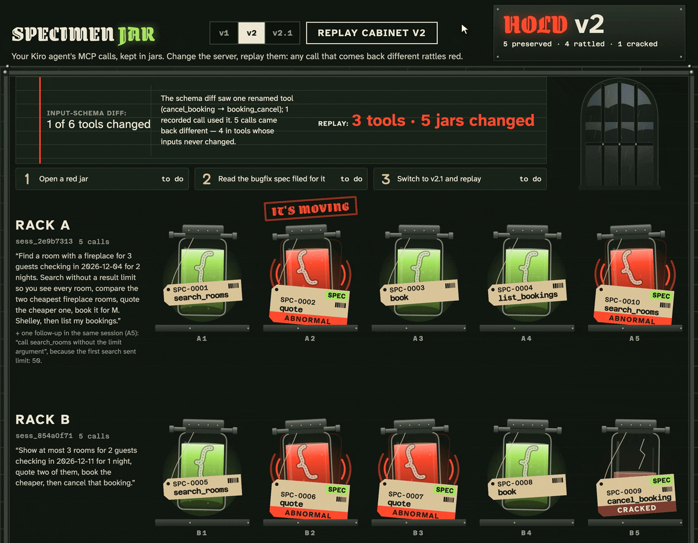
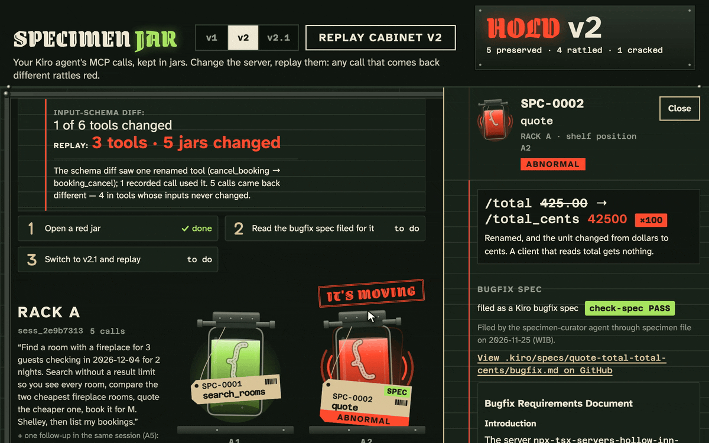
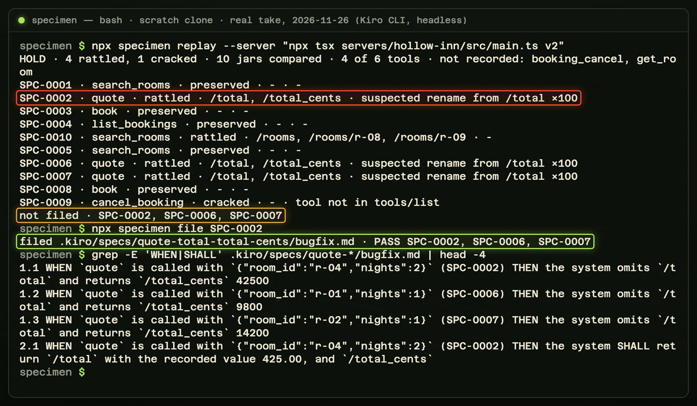
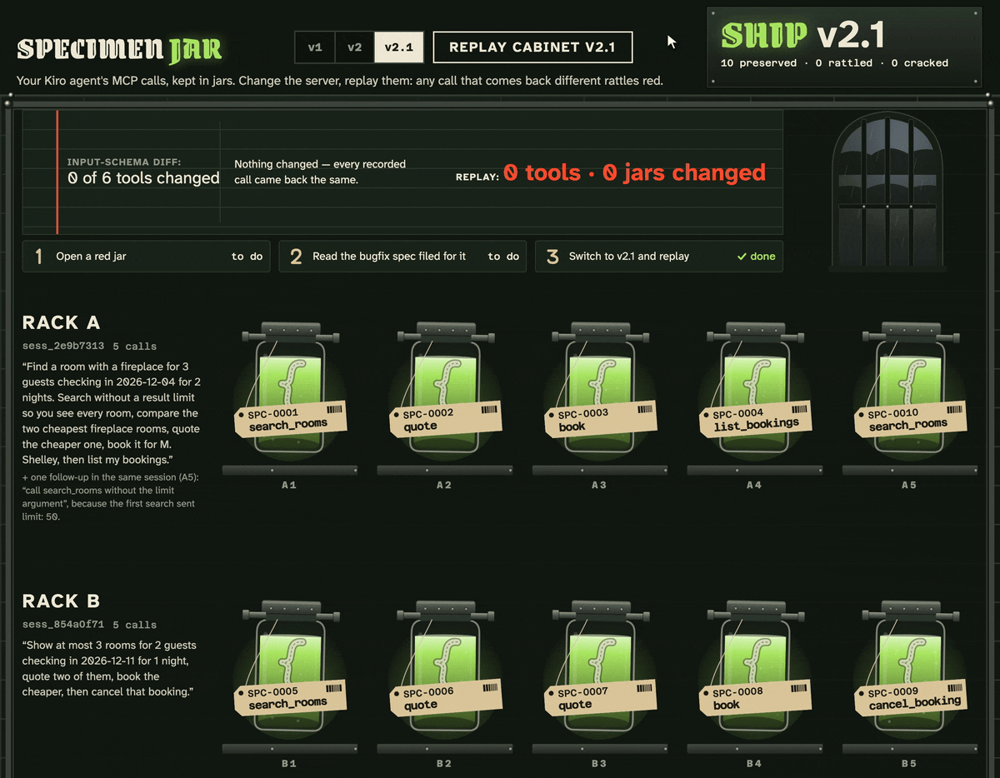

<div align="center">
  
  <h1>SPECIMEN JAR 🫙</h1>
  <p><em>Seal what your agent saw. Replay it against the new MCP server. Know what you are about to break before you ship.</em></p>
  

  <br/>

  [](https://specimen.edycu.dev/)

  [](https://youtu.be/41UlOy2X318)
  [](JUDGE.md)
  [](https://kiroween.devpost.com/)

  <br/>

  
  
  
  
  
  [](https://opensource.org/licenses/MIT)
  [](https://github.com/edycutjong/specimen/actions/workflows/ci.yml)
  [](https://github.com/edycutjong/specimen/releases/latest)
  [](https://github.com/edycutjong/specimen/actions/workflows/e2e.yml)
  [](https://github.com/edycutjong/specimen/actions/workflows/codeql.yml)
  [](https://github.com/edycutjong/specimen/actions/workflows/security.yml)
  [](https://github.com/edycutjong/specimen/actions/workflows/quality.yml)
  [](https://github.com/edycutjong/specimen/actions/workflows/live.yml)
  [](https://github.com/edycutjong/specimen/deployments/production)

</div>

---

**For anyone who maintains an MCP server that agents call.** Change the server, update its tests with it, and they stay green, while code that reads the old response breaks. SPECIMEN JAR seals the calls a Kiro agent really made (Kiro hooks, inside the agent), replays them against the new server, and files each break as a Kiro bugfix spec, with the captured calls as its repro.

**What is shown** (Kiroween 2026, Frankenstein category): our demo server's v2, with breaks we planted, turns 5 of the 10 jars recorded from real Kiro sessions red while an input-schema diff sees 2 changes; three bugfix specs are filed for the red jars, Kiro designs the fixes and executes them (we ran the final acceptance of two), and v2.1 replays SHIP 10 of 10. Live cabinet: <https://specimen.edycu.dev/> — it replays the committed jars in your browser on load; capturing your own calls takes `specimen init` and the Kiro hooks in your own repository.

## 📸 See it in Action

<p align="center">
  
</p>

*The live cabinet at real speed: switch to hollow-inn v2 and replay the 10 jars recorded from real Kiro sessions. Five come back different (four rattle red, one cracks because its tool is gone from `tools/list`) and the plate says HOLD, while the input-schema diff above the shelves counts 1 of 6 tools changed (the renamed `cancel_booking`). Captured from <https://specimen.edycu.dev/> with Playwright (CDP screencast at 2×, real time); the cursor is drawn in, nothing on the page is edited.*

## 💡 The Problem & Solution

### The Problem

You change an MCP server: a field is renamed, a default moves, a tool is renamed. Its tests are updated with it and stay
green. The callers find out in production. In our demo, a 56-line client written for v1 throws on the missing `total`, is
offered 5 of 9 rooms and cannot cancel; the Kiro agent itself still answered `$425.00`, most likely because v2's tool
description names `total_cents` (consequence rows below). An input-schema diff of `tools/list` sees only part of it: it
reports 2 changes for the v2 server while 5 of the 10 recorded calls come back different.

<p align="center">
  
</p>

*Open a red jar and the replay names the break: `quote` now answers `/total_cents 42500` where the jar holds `/total 425.00` (renamed, ×100). An input-schema diff cannot see it, because `quote`'s inputs never changed. The jar's Kiro bugfix spec is already filed and passed `check-spec`. Live cabinet, real speed.*

### The Solution

1. **Capture** — Kiro hooks (`PreToolUse` / `PostToolUse` on the MCP server's tools) seal every real tool call a Kiro agent makes as a *jar*:
   request, response text byte for byte, redacted on write. Jars are checksummed (`jars/MANIFEST.sha256`).
2. **Replay** — `specimen replay --server "<command>"` starts a fresh instance of the changed server per recorded session, replays the
   jars in order, and compares each response with the jar: **preserved**, **rattled** (came back different), **cracked** (the call
   no longer works). The detector names a likely rename or unit change (`/total` → `/total_cents`, ×100).
3. **Verdict** — `SHIP` only when the replay is clean on the recorded set, always printed with its coverage; otherwise `HOLD`.
4. **File** — `specimen file <jar>` has a Kiro curator agent write a bugfix spec for the red jar (repro block + diff written by
   the CLI, prose by Kiro); `specimen check-spec` verifies it is structurally valid and names the jarred reference.
5. **Fix** — Kiro's Bug Fix workflow designs and executes the fix; the replay turns the jar calm again.
6. **Gate** — a Kiro `Stop` hook (`specimen hook stop`) replays the jars when a turn changed the server and sends the agent back, with the jar ids as the reason,
   while a red jar has no filed bugfix spec (an operational crack — a timeout, a server that will not start — is logged, never blocked on).
   It blocks at most 3 times per session and fails open on any error or timeout.
   The committed hook (`.kiro/hooks/specimen-jar-stop.json`) replays the current server, hollow-inn v2.1, which is SHIP, so
   in this repository as committed it allows every stop until someone changes v2.1; the blocks in the table below were
   measured in scratch copies against v1 or v2 (how each row was produced: [`DEMO.md` §7](DEMO.md#7-the-stop-gate)).

<p align="center">
  
</p>

*File: `specimen file SPC-0002` hands the red `quote` jar to the Kiro curator agent, which writes `.kiro/specs/quote-total-total-cents/bugfix.md`; the CLI checks it (`PASS` for all three `quote` jars), and its requirements cite the jarred calls. The real terminal take from the demo video (2026-11-26, a scratch clone with the committed `quote` spec removed), replayed byte for byte; the curator's two runs took 36.5 s and are shown ×24, labelled on screen. Provenance: [`evidence/video-takes.md`](evidence/video-takes.md).*

<p align="center">
  
</p>

*Fix: hollow-inn v2.1, fixed by Kiro from the three filed bugfix specs, replays SHIP · 10 of 10 preserved on the recorded set (default mode: the three `quote` jars keep `total` and gain `total_cents`, a compatible addition; `--strict` says HOLD · 3 rattled). Live cabinet, real speed.*

## 🏗️ Architecture & Tech Stack

<p align="center">
  
</p>

The loop in one figure, drawn from the code as built (every box is a path in this repository): the seven Kiro hook files run `specimen hook` on each call, `specimen replay` runs the jars against the next server version (the strips are the measured outcome of each of the 10 jars), a red jar can be filed as a Kiro bugfix spec (`specimen file`), and Kiro's Bug Fix workflow writes the fix. The same `@specimen/core` runs in the CLI and in the browser pages on Vercel. Contracts and file names: [`ARCHITECTURE.md`](ARCHITECTURE.md).

| Part | What | Tech |
|---|---|---|
| `packages/core` | jar format, pairing, redaction, replay, diff, verdict — shared by the hook, the CLI and the browser cabinet | TypeScript, zod |
| `packages/cli` | the `specimen` command: hook, replay, check-spec, file, init | commander |
| `servers/hollow-inn` | the demo MCP server, v1 / v2 / v2.1 | MCP TS SDK |
| `apps/cabinet` | the browser cabinet; replays the committed jars in the page | Vite, React |
| `jars/` `replays/` `evidence/` | the sealed racks, the replay results, every measured output | JSONL, Markdown |
| `.kiro/` `prompts/` | Kiro steering, hooks, specs, agents; every Kiro prompt, numbered | Kiro |

## 🏆 How Kiro Was Used

Kiro is the builder, and every prompt that built this repository is in [`prompts/`](prompts/), verbatim and numbered (49 turns), with its measured credit cost; the few exceptions are listed in `prompts/README.md`.

- **Steering and agents** — `.kiro/steering/` (product, tech, structure, bugfix) and the curator agent `.kiro/agents/specimen-curator.json`
  were written by Kiro; the curator runs with no blanket trust and a deny rule on writes outside `.kiro/specs/`
  (spike S5, `evidence/spikes/S5.md`).
- **Hooks** — capture, the Stop gate and its turn snapshot (`UserPromptSubmit`; the `specimen hook stop` / `hook prompt` code is Kiro's turn 48, which we then edited (the `SPECIMEN_GATE=off` switch and the `UserPromptSubmit` trigger name, and later the rule that only a red jar `specimen file` can file may block a stop while operational cracks go to `unresolved.md`, were `claude-direct:` fixes, commit 97403f7); the two hook JSON files are generated by `specimen init` and were committed by us), firewall (a `PreToolUse` hook on Kiro's `write` tool that blocks an edit to a jar: "jars are evidence and read-only"; shell writes are caught only by the manifest check), manifest check and a post-task test hook
  (`.kiro/hooks/`).
- **Feature specs** — `jar-capture`, `replay-engine`, `cabinet-ui`: requirements → Analyze Requirements → design → tasks, executed by Kiro
  (`.kiro/specs/`).
- **Bug Fix specs** — three, one per v2 break, filed by the curator from the CLI's repro block; Kiro wrote the design and tasks and executed them
  into `servers/hollow-inn/src/v2_1.ts`.
- **What Kiro did not write** — the hollow-inn demo server v1 and v2 (the planted breaks are ours), test harnesses and glue
  (commits starting `claude-direct:`: glue, fixes found while reviewing Kiro's output, the eval and probe scripts, the readiness script, the docs, and the landing page and deck in `site/`). The bugfix workflow ran headless: no IDE approval step was taken. Turn 43 stopped by itself at its final acceptance task
  (headless, it could not ask whether to update the cabinet tests that pin the old counts) and three execution turns (45, 46, 47)
  were cut by our own timeout; the remaining acceptance steps were run by us, outside Kiro, and are labelled so in `prompts/README.md`.
  Credits, friction and the measured rate: [`docs/DX-REPORT.md`](docs/DX-REPORT.md).

## 📊 Engineering Rigor

| What | Result | Evidence |
|---|---|---|
| hollow-inn v1, self-replay | SHIP · 10 of 10 jars preserved | `evidence/bench/detect.md` |
| hollow-inn v2 (three author-made breaks) | HOLD · 5 preserved · 4 rattled · 1 cracked | `evidence/bench/detect.md`, `evidence/replay/racks-vs-v2.txt` |
| input-schema diff of the same v2 change | 2 changes (removed `cancel_booking`, added `booking_cancel`); the `quote` rename and the `search_rooms` default are invisible to it: neither touches `inputSchema` (the default is applied in the handler, `limit ?? 20` → `limit ?? 5`); both tools' description text did change (`default 20` → `default 5`; `total` → `total_cents`), which this diff does not compare — prose that says a value changed, not which recorded calls now get a different answer | `evidence/bench/detect.md` |
| `specimen hook pre` / `post` latency (30 fresh `npx` processes each, CLI wall-clock excluding Kiro's own hook launch, this laptop) | pre p50 465 ms · p95 628 ms; post p50 474 ms · p95 668 ms (the stop hook's budget is 30 s) | `evidence/bench/hook.md` |
| `specimen replay` of all 10 jars (10 cold runs per server, this laptop) | v1 p50 2254 ms; v2.1 p50 2365 ms (p95 = slowest of 10: 2780 / 2452 ms) | `evidence/bench/replay.md` |
| hollow-inn v2.1 (fixed by Kiro from three filed bugfix specs) | SHIP · 10 of 10 preserved · 5 of 6 tools covered (`get_room` was never called by the agent). 3 of the 10 are `quote` jars that keep `total` and also carry the new `total_cents` field, which the default mode counts as a compatible addition; with `--strict` the same replay is HOLD · 3 rattled | `evidence/replay/racks-vs-v2.1-ship.txt`, `evidence/replay/racks-vs-v2.1-strict.txt` |
| Stop gate, E1–E3 (the real `specimen hook` commands driven with scripted Stop payloads; no Kiro session) | v1 → allow; v2 with no spec → block naming all 5 red jars; v2 with the `quote` spec filed → block naming only SPC-0009, SPC-0010; 4th stop → allow + `unresolved.md`; 2.3–2.8 s per replaying stop, 0.4 s when nothing under `servers/` changed | `evidence/stop-gate/eval.md` |
| Stop gate in a live headless Kiro session (N = 1 retained run per row, an earlier set of probes was overwritten by the re-runs (`prompts/README.md`); the prompt tells the agent what to do if a hook sends it back; its edit, one comment line in `servers/`, is unrelated to the red jars, which come from the server under test being v2) | gate ON: the agent was sent back once and ran `specimen file` for the red jars; without shell trust it said it could not; gate OFF: it answered DONE; a turn that edited nothing was not blocked | `evidence/stop-gate/live-shell.md`, `live.md` (no shell trust), `live-control-off.md`, `live-no-edit.md` |
| Stop gate, break arm (N = 1 per arm; scratch at hollow-inn v1; prompt = "rename quote's `total` to `total_cents`, integer cents, reply DONE"; the prompt says nothing about hooks or replay, but the gate's own block reason does tell the agent what to do, and the rename was the requested change, so this is not an accident) | gate ON (171 s): the agent changed 2 lines and said DONE, was sent back once, replayed, ran `specimen file` for the 3 broken `quote` jars (the first filing call failed and was retried), the curator's check rejected the draft (`expected does not name the reference`), no spec was accepted, and the agent stopped with the jars still rattled and asked whether to keep the rename or revert it; gate OFF (about 20 s): 2 changed lines, DONE, "I did not run the test suite or the replay", nothing flagged. Gate ON cost 2.12 credits (6 curator sessions; figure from `prompts/README.md`, no credit output committed for these two runs), gate OFF 0.04; the unresolved ON turn is what `specimen seal` (accept an intended change, not built) would resolve | `evidence/stop-gate/live-break-on.md`, `live-break-off.md` |
| Tests | 1090 passing in 123 files (vitest + fast-check), `tsc --noEmit` exit 0 | `evidence/tests.txt` |
| End-to-end (Playwright, Chromium) | 13 passing on the built site, and the same 13 against <https://specimen.edycu.dev/> after every deploy and every 6 hours: the cabinet's v2 HOLD (5 preserved · 4 rattled · 1 cracked), v2.1 and v1 SHIP, the keyboard server switch, the landing's live replay, the deck's keys, no third-party request, no sideways scroll at 320 and 375 px | `e2e/judge-path.spec.ts`, `.github/workflows/e2e.yml`, `live.yml` |
| Lighthouse CI (desktop preset, 3 runs per page) | cabinet, landing and deck held to performance ≥ 0.9, accessibility ≥ 0.95, best practices ≥ 0.95, SEO ≥ 0.9, script ≤ 250 KB and page ≤ 400 KB transferred; on this laptop all three scored performance 100 and accessibility 100, except the cabinet at 96 (the contrast limit 5 below) | `lighthouserc.json`, `.github/workflows/quality.yml` |
| Consequence run: did the agent's own answer change under v2? | No — its answer was unchanged (`$425.00`); v2's tool description names `total_cents` and the agent had it loaded (no ablation was run, so that is the likely reason, not a measurement). A deterministic consumer written against v1 (`scripts/consumer.ts`) was run since | `evidence/consequence-v2/README.md` |
| Consequence run, part 2: a client that reads `total` (our v1-era consumer, a 56-line script with no tool descriptions to read) | v2: the charge line throws (`total` is undefined), 5 of 9 rooms offered, cancel fails (`cancel_booking` not found); v2.1: every line matches v1 (`USD 425.00`, 9 rooms, cancelled) | `evidence/consequence-v2/consumer.md` |
| Field shelf: a public MCP server (`server-memory` 1.0.0 → 2.2.1) | HOLD · 3 preserved · 2 unsealed — no break found (a null result, reported as one); 2 jars unsealed because the server also returns a `structuredContent` its text does not carry, which a text-only jar cannot compare | `evidence/field/server-memory.md` |

The three breaks in hollow-inn v2 are **author-made on purpose** (`servers/hollow-inn/CHANGES.md`); the demo server is ours. The
field shelf is the only run against a server we did not write: it found no rattled or cracked jar (verdict HOLD: 3 preserved, 2 unsealed), and it found a limit of our own jar format (text only).

### Honest limits (6)

1. **Not the first MCP record/replay tool.** `mcp-recorder` ([devhelmhq/mcp-recorder](https://github.com/devhelmhq/mcp-recorder)), AgentVCR ([Victorchatter/AgentVCR](https://github.com/Victorchatter/AgentVCR)) and mcpsnoop ([kerlenton/mcpsnoop](https://github.com/kerlenton/mcpsnoop)) exist. What differs here is capture *inside* the agent
  through Kiro hooks (no proxy) and the closed loop into a Kiro bugfix spec.
2. Ten jars from two racks, five of six hollow-inn tools. "SHIP" means *replay clean on the recorded set*, nothing more.
3. **Everything ran on the Kiro CLI, headless.** Capture, replay, filing and the Stop gate were never run inside the Kiro IDE; the IDE-only steps (S2-IDE, Spec Correctness, IDE bugfix approvals) were not run. On the CLI the gate gets one block per prompt (the continuation turn fires no second Stop), so the 3-block cap is exercised only by the scripted evals, and each live variant has one retained run.
4. No unscripted 3-person timing of the judge path has been done.
5. axe-core still reports `color-contrast` on 25–28 nodes per width: the toe-tag text (measured 10.24:1), the jar flag strips (5.21:1 and 6.74:1 computed from tokens, not pixel-verified) and one legend item. We do not claim 0 axe violations. Everything else axe checks is clean at 1440, 375 and 320 px (`evidence/interaction-qa.md`).
6. No outside user has run it yet.

## 🚀 Getting Started

```sh
npm ci
npm test
npx specimen replay --server "npx tsx servers/hollow-inn/src/main.ts v2"     # HOLD, exit 3 once its red jars are filed
npx specimen replay --server "npx tsx servers/hollow-inn/src/main.ts v2.1"   # SHIP, exit 0
npm run bench -- detect                                                      # rewrites evidence/bench/detect.md
npm run bench -- hook                                                        # p50/p95 of the capture hooks → evidence/bench/hook.md
npm run bench -- replay                                                      # p50/p95 of a full replay → evidence/bench/replay.md
npm run build:site && npm run test:e2e                                       # the Vercel build, then the Playwright judge-path suite
```

A Kiro Power with the workflow as one skill is in [`power/specimen/`](power/specimen/) (`plugin.json` + `skills/specimen-replay/SKILL.md`, written by Kiro in turn 49; no MCP server in it, and it has not been imported in the Kiro IDE).

Add it to your own project with `specimen init` (writes the Kiro hooks, an `mcp.json` entry check, `.specimen/replay.json` with
a replay allow-list pre-filled from `readOnlyHint`, and checks the `kiro-cli` engine). Reproduction steps with the expected
outputs pasted from real runs: [`DEMO.md`](DEMO.md).

## 🧪 Testing & CI

Six GitHub Actions workflows (the badges above are their live state). Five run on every push to `main` and every pull request; the sixth, Deploy & Live, deploys `main` once CI has passed on it:

| Workflow | What it checks |
|---|---|
| [`ci.yml`](.github/workflows/ci.yml) | `tsc --noEmit`, the vitest + fast-check suite, `npm run seed:check` and the exact Vercel build (`vercel.json` buildCommand), on Node 22 and 24 |
| [`e2e.yml`](.github/workflows/e2e.yml) | Playwright drives the built cabinet, landing and deck in Chromium (`e2e/judge-path.spec.ts`) |
| [`codeql.yml`](.github/workflows/codeql.yml) | CodeQL `security-extended` on the TypeScript and on these workflow files |
| [`security.yml`](.github/workflows/security.yml) | gitleaks over the full git history, `npm audit` (moderate and above) and `npm audit signatures`; on pull requests, dependency review |
| [`quality.yml`](.github/workflows/quality.yml) | Lighthouse CI with score floors and byte budgets (`lighthouserc.json`) |
| [`live.yml`](.github/workflows/live.yml) | **Deploy & Live.** When CI passes on a push to `main` (and that commit is still the head of `main`), it deploys the commit to Vercel production — `vercel pull` → `vercel build --prod` → `vercel deploy --prebuilt --prod`, Vercel CLI pinned, recorded as a GitHub deployment to the `production` environment — after checking the build has every page and that its repository switch matches the repository's visibility (`static/repo.json` = `{"public":true}` while the repo is public), then checks that the live `index.html` is byte-identical to that build. Then every page and static file of <https://specimen.edycu.dev/> answers 200 and the e2e suite runs against the live site. The live checks also run on their own every 6 hours |

Dependabot groups npm and Actions updates weekly (`.github/dependabot.yml`).

```sh
npm run typecheck && npm test        # what ci.yml runs
npm run build:site && npm run test:e2e
E2E_BASE_URL=https://specimen.edycu.dev npm run test:e2e   # the same suite against the live site
npx @lhci/cli@0.16.1 autorun         # Lighthouse CI, after build:site
```

## 📄 License

MIT licensed — see [`LICENSE`](LICENSE).
